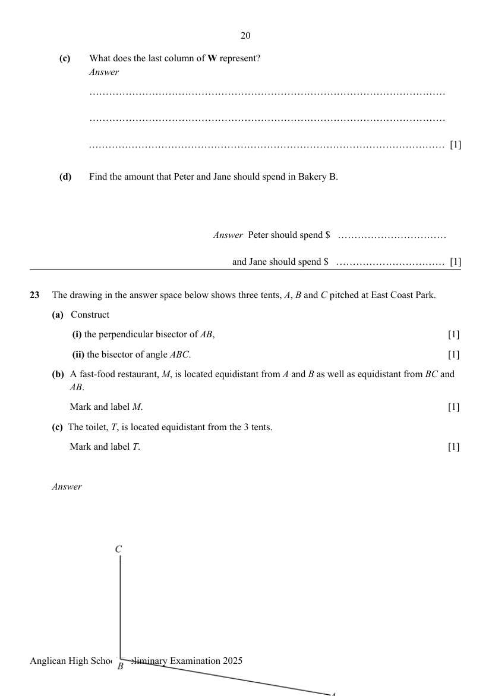

## Question

> **Marks:** (a)(i) 1, (a)(ii) 1, (b) 1, (c) 1; total 4
> **Page:** 20

The drawing in the answer space below shows three tents, $A$, $B$ and $C$ pitched at East Coast Park.

**(a)** Construct

**(i)** the perpendicular bisector of $AB$, [1]

**(ii)** the bisector of angle $ABC$. [1]

**(b)** A fast-food restaurant, $M$, is located equidistant from $A$ and $B$ as well as equidistant from $BC$ and $AB$. Mark and label $M$. [1]

**(c)** The toilet, $T$, is located equidistant from the 3 tents. Mark and label $T$. [1]

## Answer Scheme

- **(a)(i):** Correct perpendicular bisector of $AB$.
- **(a)(ii):** Correct bisector of $ngle ABC$.
- **(b):** $M$ is the intersection of the perpendicular bisector of $AB$ and the bisector of $ngle ABC$.
- **(c):** $T$ is the point equidistant from $A$, $B$ and $C$ (the circumcentre).
