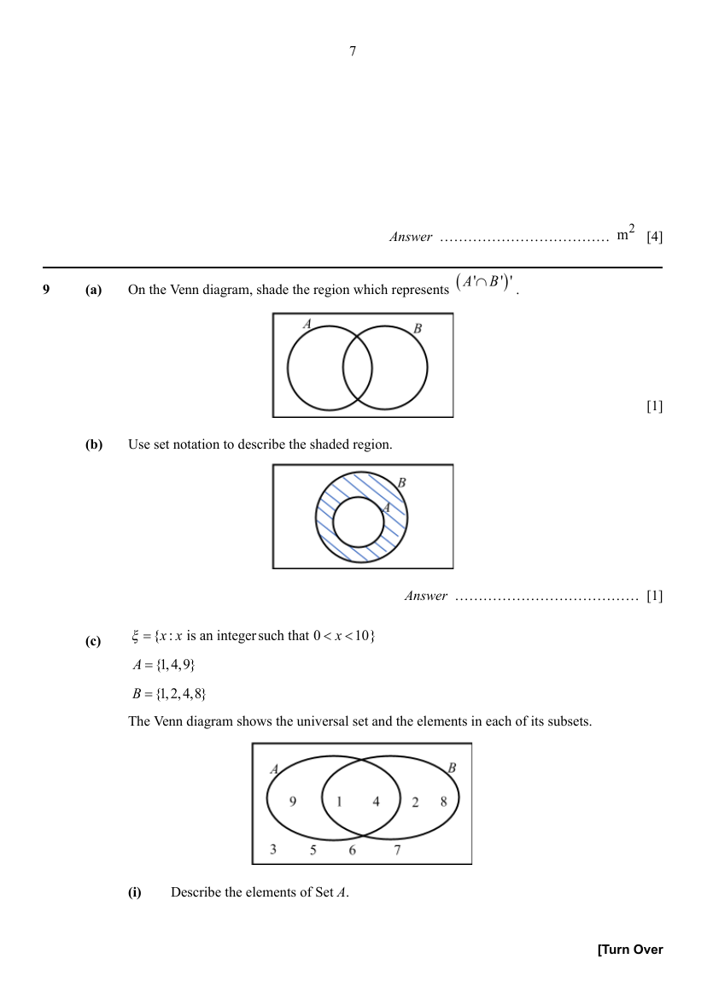
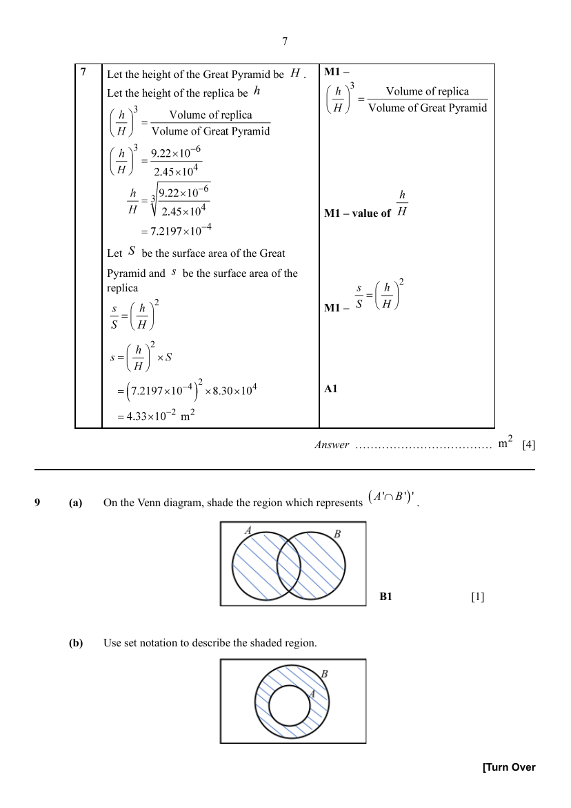

## Question

> **Marks:** (a) 1, (b) 1, (c)(i) 1, (c)(ii) 1; total 4
> **Page:** 7–8

**(a)** On the Venn diagram, shade the region which represents $(A'\cap B')'$. [1]

**(b)** Use set notation to describe the shaded region. [1]

**(c)** $\xi=\{x:x\text{ is an integer such that }0<x<10\}$

$A=\{1,4,9\}$

$B=\{1,2,4,8\}$

The Venn diagram shows the universal set and the elements in each of its subsets.

**(i)** Describe the elements of Set $A$. [1]

**(ii)** Find the value of $n(A\cup B')$. [1]

## Answer Scheme

**(a)** On the Venn diagram, shade the region which represents $(A'\cap B')'$.

The region inside $A$ or $B$ (the union) is shaded.

**B1**

**(b)** Use set notation to describe the shaded region.

$$
A'\cap B
$$

**B1**

**(c)** $\xi=\{x:x\text{ is an integer such that }0<x<10\}$

$A=\{1,4,9\}$

$B=\{1,2,4,8\}$

**(i)** Describe the elements of Set $A$.

Perfect square, square numbers.

**B1**

**(ii)** Find the value of $n(A\cup B')$.

$$
n(A\cup B')=7
$$

**B1**
