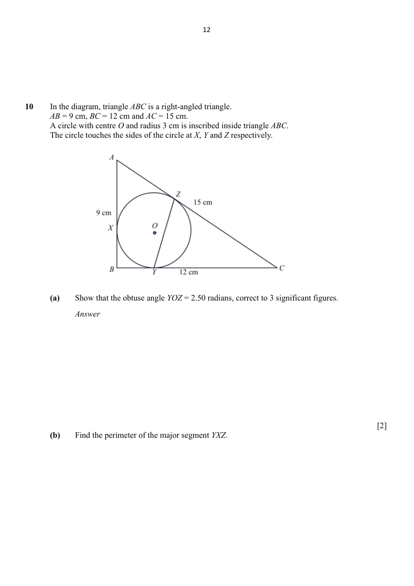

## Question

> **Marks:** (a) [2]; (b) [4]; total [6]
> **Page:** 12–13

In the diagram, triangle $ABC$ is a right-angled triangle. $AB=9$ cm, $BC=12$ cm and $AC=15$ cm. A circle with centre $O$ and radius $3$ cm is inscribed inside triangle $ABC$. The circle touches the sides of the circle at $X$, $Y$ and $Z$ respectively.

**(a)** Show that the obtuse angle $YOZ=2.50$ radians, correct to 3 significant figures. [2]

**(b)** Find the perimeter of the major segment $YXZ$. [4]

## Answer Scheme

In the diagram, triangle $ABC$ is a right-angled triangle. $AB=9$ cm, $BC=12$ cm and $AC=15$ cm. A circle with centre $O$ and radius $3$ cm is inscribed inside triangle $ABC$. The circle touches the sides of the circle at $X$, $Y$ and $Z$ respectively.

**(a)** Show that the obtuse angle $YOZ=2.50$ radians, correct to 3 significant figures.

$$
\begin{aligned}
\tan\angle YOC&=\dfrac{9}{3}\\
\angle YOC&=\tan^{-1}(3)\\
&=1.2490\ \mathrm{rad}\\
\therefore\ \angle YOZ&=2\times 1.2490\ \mathrm{rad}\\
&=2.50\ \mathrm{rad}\ (3\text{ s.f.})\ (\text{shown})
\end{aligned}
$$

**M1** for finding angle $YOC$ and angle $YOZ$. **A1**

**(b)** Find the perimeter of the major segment $YXZ$.

$$
\begin{aligned}
\text{Length of major arc }YXZ&=3(2\pi-2.50)\ \mathrm{cm}\\
&=11.34956\ \mathrm{cm}\\
\text{Length of chord }YZ&=\sqrt{3^{2}+3^{2}-2\times 3\times 3\cos 2.50}\ \mathrm{cm}\\
&=5.69391\ \mathrm{cm}\\
\text{Perimeter of major segment }YXZ&=11.34956+5.69391\ \mathrm{cm}\\
&=17.04347\ \mathrm{cm}\\
&=17.0\ \mathrm{cm}\ (3\text{ s.f.})
\end{aligned}
$$

**M1** for finding length of major arc. **M2** for find length of chord $YZ$ using cosine rule. **A1**
