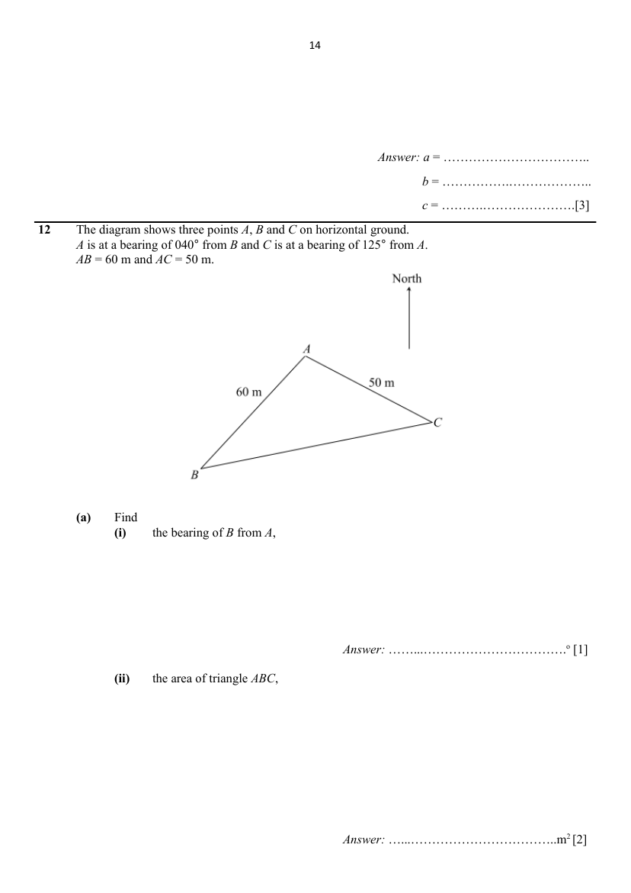

## Question

> **Marks:** (a)(i) [1]; (a)(ii) [2]; (a)(iii) [2]; (a)(iv) [2]; (a)(v) [2]; (b) [3]; total [12]
> **Page:** 14–16

The diagram shows three points $A$, $B$ and $C$ on horizontal ground. $A$ is at a bearing of $040^{\circ}$ from $B$ and $C$ is at a bearing of $125^{\circ}$ from $A$. $AB=60$ m and $AC=50$ m.

**(a)** Find

**(i)** the bearing of $B$ from $A$, [1]

**(ii)** the area of triangle $ABC$, [2]

**(iii)** the distance $BC$, [2]

**(iv)** angle $ACB$, [2]

**(v)** the shortest distance $AX$, where $X$ is a point along $BC$. [2]

**(b)** Point $A$ is the base of a vertical mast $AT$. The angle of depression of $C$ from the $T$ is $33^{\circ}$. Find the greatest angle of elevation of $T$ from a point along $BC$. [3]

## Answer Scheme

The diagram shows three points $A$, $B$ and $C$ on horizontal ground. $A$ is at a bearing of $040^{\circ}$ from $B$ and $C$ is at a bearing of $125^{\circ}$ from $A$. $AB=60$ m and $AC=50$ m.

**(a)** Find

**(i)** the bearing of $B$ from $A$,

Bearing of $B$ from $A=360^{\circ}-140^{\circ}$ (sum of interior angles, // North lines) $=220^{\circ}$.

**B1**

**(ii)** the area of triangle $ABC$,

$$
\begin{aligned}
\text{Angle }BAC&=220^{\circ}-125^{\circ}\\
&=95^{\circ}\\
\text{Area of triangle }ABC&=\dfrac{1}{2}\times 60\times 50\times\sin 95^{\circ}\\
&=1494.29\ \mathrm{m}^{2}\\
&=1490\ \mathrm{m}^{2}\ (3\text{ s.f.})
\end{aligned}
$$

**M1** for angle $BAC$. **A1**

**(iii)** the distance $BC$,

$$
\begin{aligned}
BC&=\sqrt{60^{2}+50^{2}-2(60)(50)\cos 95^{\circ}}\\
&=81.3814\ \mathrm{m}\\
&=81.4\ \mathrm{m}\ (3\text{ s.f.})
\end{aligned}
$$

**M1** for cosine rule. **A1**

**(iv)** angle $ACB$,

$$
\begin{aligned}
\dfrac{60}{\sin\angle ACB}&=\dfrac{81.3814}{\sin 95^{\circ}}\\
\sin\angle ACB&=\dfrac{60\sin 95^{\circ}}{81.3814}\\
\angle ACB&=47.262^{\circ}\\
&=47.3^{\circ}\ (1\text{ d.p.})
\end{aligned}
$$

**M1** for using sine rule. **A1**

**(v)** the shortest distance $AX$, where $X$ is a point along $BC$.

$AX$ is the perpendicular distance from $A$ to $BC$.

Method 1:

$$
\begin{aligned}
\dfrac{1}{2}BC\times AX&=\dfrac{1}{2}\times 60\times 50\times\sin 95^{\circ}\\
AX&=\dfrac{60\times 50\times\sin 95^{\circ}}{81.3814}\\
&=36.723\ \mathrm{m}\\
&=36.7\ \mathrm{m}\ (3\text{ s.f.})
\end{aligned}
$$

Method 2:

$$
\begin{aligned}
\sin 47.262^{\circ}&=\dfrac{AX}{50}\\
AX&=50\sin 47.262^{\circ}\\
&=36.723\ \mathrm{m}\\
&=36.7\ \mathrm{m}\ (3\text{ s.f.})
\end{aligned}
$$

**M1** for equating area of triangle. **A1** **M1** for using sine rule. **A1**

**(b)** Point $A$ is the base of a vertical mast $AT$. The angle of depression of $C$ from the $T$ is $33^{\circ}$. Find the greatest angle of elevation of $T$ from a point along $BC$.

Let height of vertical mast be $p$ m.

$$
\begin{aligned}
\tan 33^{\circ}&=\dfrac{p}{50}\\
p&=50\tan 33^{\circ}\\
&=32.470\ \mathrm{m}
\end{aligned}
$$

Greatest angle of depression is at perpendicular distance of $A$ from $BC$, which is $AX$.

$$
\begin{aligned}
\tan\angle AXT&=\dfrac{AT}{AX}\\
\angle AXT&=\tan^{-1}\left(\dfrac{32.470}{36.723}\right)\\
&=41.483^{\circ}\\
&=41.5^{\circ}\ (1\text{ d.p.})
\end{aligned}
$$

**M1** for finding height of mast. **M1** for TOA. **A1**
