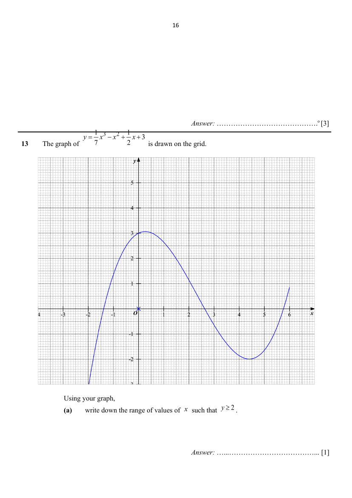

## Question

> **Marks:** (a) [1]; (b) [2]; (c) [3]; total [6]
> **Page:** 16–17

The graph of $y=\dfrac{1}{7}x^{3}-x^{2}+\dfrac{1}{2}x+3$ is drawn on the grid.

Using your graph,

**(a)** write down the range of values of $x$ such that $y\geq 2$. [1]

**(b)** find the gradient of the tangent to the curve where $x=-0.5$. [2]

**(c)** by drawing a suitable straight line on the grid, solve the equation

$$
6x^{3}-42x^{2}+126=21x.
$$

[3]

## Answer Scheme

The graph of $y=\dfrac{1}{7}x^{3}-x^{2}+\dfrac{1}{2}x+3$ is drawn on the grid.

Using your graph,

**(a)** write down the range of values of $x$ such that $y\geq 2$.

$-0.75\leq x\leq 1.50$. Accept answers $\pm 0.1$ from the limits.

**B1**

**(b)** find the gradient of the tangent to the curve where $x=-0.5$.

Gradient $=1.6$. Accept $\pm 0.2$.

**M1** — the tangent is drawn. **A1**

**(c)** by drawing a suitable straight line on the grid, solve the equation $6x^{3}-42x^{2}+126=21x$.

$$
\begin{aligned}
6x^{3}-42x^{2}+126&=21x\\
x^{3}-7x^{2}+21&=\dfrac{7}{2}x\\
\dfrac{1}{7}x^{3}-x^{2}+3&=\dfrac{1}{2}x\\
\dfrac{1}{7}x^{3}-x^{2}+\dfrac{1}{2}x+3&=\dfrac{1}{2}x+\dfrac{1}{2}x\\
&=x
\end{aligned}
$$

Consider the intersection of $y=\dfrac{1}{7}x^{3}-x^{2}+\dfrac{1}{2}x+3$ and the line $y=x$.

$x=1.7$ or $x=-1.7$. Accept $\pm 0.1$.

**M1** for obtain the straight line. **M1** for drawing the straight line. **A1**
