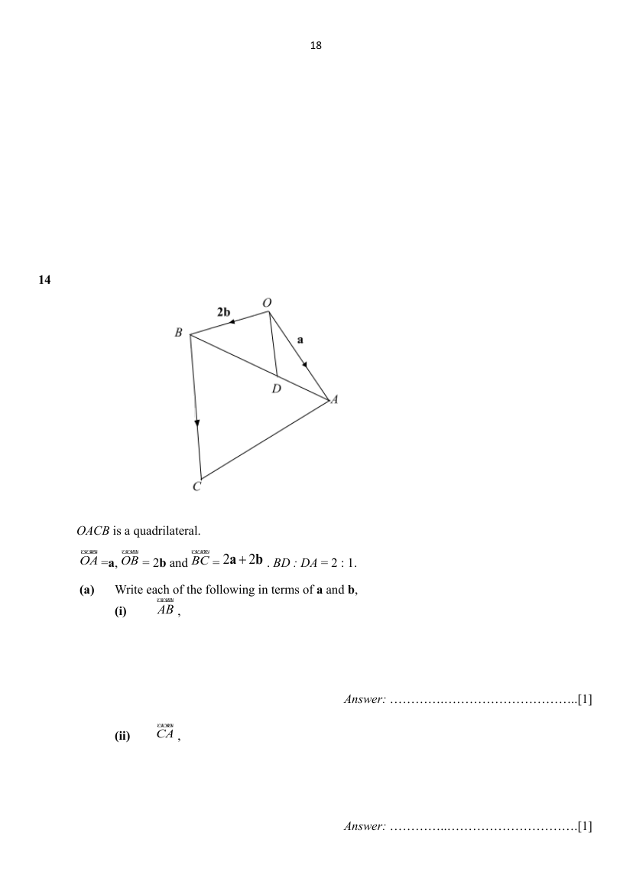

## Question

> **Marks:** (a)(i) [1]; (a)(ii) [1]; (a)(iii) [1]; (b) [1]; (c) [1]; (d)(i) [1]; (d)(ii) [1]; total [7]
> **Page:** 18–20

$OACB$ is a quadrilateral.

$\overrightarrow{OA}=\mathbf{a}$, $\overrightarrow{OB}=2\mathbf{b}$ and $\overrightarrow{BC}=2\mathbf{a}+2\mathbf{b}$. $BD:DA=2:1$.

**(a)** Write each of the following in terms of $\mathbf{a}$ and $\mathbf{b}$,

**(i)** $\overrightarrow{AB}$, [1]

**(ii)** $\overrightarrow{CA}$, [1]

**(iii)** $\overrightarrow{DO}$. [1]

**(b)** Explain why $\overrightarrow{DO}$ is parallel to $\overrightarrow{BC}$. [1]

**(c)** Show that $\dfrac{\text{Area of triangle }OBD}{\text{Area of triangle }BCD}=\dfrac{1}{3}$. [1]

**(d)** Find

**(i)** $\dfrac{\text{Area of triangle }BCD}{\text{Area of triangle }CAD}$, [1]

**(ii)** $\dfrac{\text{Area of triangle }OBD}{\text{Area of triangle }CAD}$. [1]

## Answer Scheme

$OACB$ is a quadrilateral.

$\overrightarrow{OA}=\mathbf{a}$, $\overrightarrow{OB}=2\mathbf{b}$ and $\overrightarrow{BC}=2\mathbf{a}+2\mathbf{b}$. $BD:DA=2:1$.

**(a)** Write each of the following in terms of $\mathbf{a}$ and $\mathbf{b}$,

**(i)** $\overrightarrow{AB}$,

$$
\begin{aligned}
\overrightarrow{AB}&=\overrightarrow{AO}+\overrightarrow{OB}\\
&=-\mathbf{a}+2\mathbf{b}
\end{aligned}
$$

**B1**

**(ii)** $\overrightarrow{CA}$,

$$
\begin{aligned}
\overrightarrow{CA}&=\overrightarrow{CB}+\overrightarrow{BO}+\overrightarrow{OA}\\
&=-2\mathbf{a}-2\mathbf{b}-2\mathbf{b}+\mathbf{a}\\
&=-\mathbf{a}-4\mathbf{b}
\end{aligned}
$$

**B1**

**(iii)** $\overrightarrow{DO}$,

$$
\begin{aligned}
\overrightarrow{DO}&=\overrightarrow{DB}+\overrightarrow{BO}\\
&=\dfrac{2}{3}\overrightarrow{AB}-2\mathbf{b}\\
&=\dfrac{2}{3}(-\mathbf{a}+2\mathbf{b})-2\mathbf{b}\\
&=-\dfrac{2}{3}\mathbf{a}-\dfrac{2}{3}\mathbf{b}\\
&=-\dfrac{2}{3}(\mathbf{a}+\mathbf{b})
\end{aligned}
$$

**B1**

**(b)** Explain why $\overrightarrow{DO}$ is parallel to $\overrightarrow{BC}$.

$$
\begin{aligned}
\overrightarrow{BC}&=2\mathbf{a}+2\mathbf{b}\\
&=2(\mathbf{a}+\mathbf{b})\\
\overrightarrow{DO}&=-\dfrac{2}{3}(\mathbf{a}+\mathbf{b})
\end{aligned}
$$

Therefore $\overrightarrow{BC}$ is parallel to $\overrightarrow{DO}$.

$\overrightarrow{BC}$ and $\overrightarrow{DO}$ are shown in $(\mathbf{a}+\mathbf{b})$ form.

Accept $\overrightarrow{DO}=-\dfrac{1}{3}\overrightarrow{BC}$.

Accept $\overrightarrow{BC}=-3\overrightarrow{DO}$.

**B1**

**(c)** Show that $\dfrac{\text{Area of triangle }OBD}{\text{Area of triangle }BCD}=\dfrac{1}{3}$.

Method 1: using $\text{Area}=\dfrac{1}{2}ab\sin C$ to prove.

$\angle OBD=\angle DBC$ (alternate angle $CB\parallel DO$).

$$
\begin{aligned}
\dfrac{\text{Area of triangle }OBD}{\text{Area of triangle }BCD}&=\dfrac{\dfrac{1}{2}AB\times OD\sin\angle OBD}{\dfrac{1}{2}AB\times BC\sin\angle DBC}\\
&=\dfrac{OD}{BC}\\
&=\dfrac{1}{3}\quad\text{because }BC:OD=3:1
\end{aligned}
$$

Method 2: Using same height ($ht$) between $CB\parallel DO$ to prove.

$$
\begin{aligned}
\dfrac{\text{Area of triangle }OBD}{\text{Area of triangle }BCD}&=\dfrac{\dfrac{1}{2}OD_{\text{base}}\times ht}{\dfrac{1}{2}BC_{\text{base}}\times ht}\\
&=\dfrac{OD}{BC}\\
&=\dfrac{1}{3}\quad\text{because }BC:OD=3:1
\end{aligned}
$$

**B1**

**(d)** Find

**(i)** $\dfrac{\text{Area of triangle }BCD}{\text{Area of triangle }CAD}$,

$$
\begin{aligned}
\dfrac{\text{Area of triangle }BCD}{\text{Area of triangle }CAD}&=\dfrac{\dfrac{1}{2}BD_{\text{base}}\times ht}{\dfrac{1}{2}AD_{\text{base}}\times ht}\\
&=\dfrac{2}{1}
\end{aligned}
$$

**B1**

**(ii)** $\dfrac{\text{Area of triangle }OBD}{\text{Area of triangle }CAD}$.

$$
\begin{aligned}
\dfrac{\text{Area of triangle }OBD}{\text{Area of triangle }CAD}&=\dfrac{\text{Area of triangle }OBD}{\text{Area of triangle }BCD}\times\dfrac{\text{Area of triangle }BCD}{\text{Area of triangle }CAD}\\
&=\dfrac{1}{3}\times\dfrac{2}{1}\\
&=\dfrac{2}{3}
\end{aligned}
$$

**B1**
