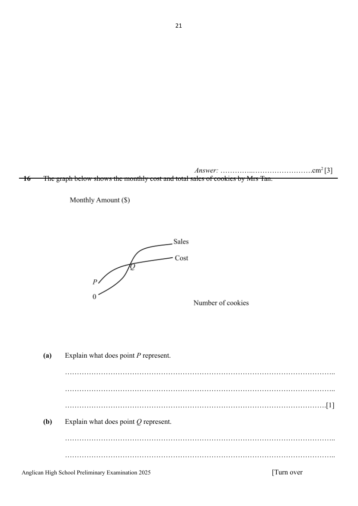

## Question

> **Marks:** (a) [1]; (b) [1]; (c) [1]; (d) [6]; (e) [1]; total [10]
> **Page:** 21–24

The graph below shows the monthly cost and total sales of cookies by Mrs Tan.

**(a)** Explain what does point $P$ represent. [1]

**(b)** Explain what does point $Q$ represent. [1]

Mrs Tan bought 3 ovens costing &#36;10 950 that will be fully depreciated (means reduced to &#36;0) in 2 years.

Each oven is to be used to bake large, medium and small cookies respectively. Each large, medium and small circular cookie has a thickness of $0.4$ cm and measures $6$ cm, $4$ cm and $3$ cm in diameter respectively.

Selling price for each large cookie is &#36;1, medium cookie is &#36;0.80 and small cookie is &#36;0.50. Order for each type of cookies must be in multiples of 20.

On a particular day, she receives orders from 18 locations amounting to a total of 160 large, 100 medium and 140 small pieces of cookies. The cost of delivery to each location is &#36;3.50.

The table below shows the cost of producing and packing the cookies on a particular day.

- Electricity and water usage : &#36;6.
- Depreciation of oven : &#36;15.
- Cost of delivery.
- Cost of materials.
- Cost of packaging.

The cost of materials are shown in the table below.

| Each piece of | Cost of material |
| --- | --- |
| Large cookie | 20 cents |
| Medium cookie | 15 cents |
| Small cookie | 11 cents |

Mrs Tan wants to pack exactly 20 cookies in each container. The table below shows the dimensions and cost of the different types of containers from a supplier for her to select.

| Dimensions of circular containers available |  | Cost of each circular container |
| --- | --- | --- |
| Diameter (cm) | Height (cm) |  |
| 7 | 10 | &#36;0.60 |
| 6 | 7 | &#36;0.50 |
| 5 | 10 | &#36;0.40 |
| 4 | 7 | &#36;0.30 |

**(c)** By taking 1 year to be 365 days, show that the depreciation cost of the 3 ovens per day is &#36;15. [1]

**(d)** Calculate Mrs Tan's profit from the sales of cookies on this particular day. [6]

**(e)** Without raising the price of the large, medium and small cookies, suggest a way to help Mrs Tan increase the profit margin. [1]

## Answer Scheme

The graph below shows the monthly cost and total sales of cookies by Mrs Tan.

**(a)** Explain what does point $P$ represent.

$P$ represents the depreciation cost of the oven

or

$P$ is the cost incurred without making any cookies.

**B1**

**(b)** Explain what does point $Q$ represent.

$Q$ represents the break even cost.

Alternatively, when cost is equal to sales received o.e.

**B1**

Mrs Tan bought 3 ovens costing SGD 10 950 that will be fully depreciated (means reduced to SGD 0) in 2 years.

Each oven is to be used to bake large, medium and small cookies respectively. Each large, medium and small circular cookie has a thickness of $0.4$ cm and measures $6$ cm, $4$ cm and $3$ cm in diameter respectively.

Selling price for each large cookie is SGD 1, medium cookie is SGD 0.80 and small cookie is SGD 0.50. Order for each type of cookies must be in multiples of 20.

On a particular day, she receives orders from 18 locations amounting to a total of 160 large, 100 medium and 140 small pieces of cookies. The cost of delivery fee to each location is SGD 3.50.

The table below shows the cost of producing and packing the cookies on a particular day.

- Electricity and water usage : SGD 6.
- Depreciation of oven : SGD 15.
- Cost of delivery.
- Cost of materials.
- Cost of packaging.

The cost of materials are shown in the table below.

| Each piece of | Cost of material |
| --- | --- |
| Large cookie | 20 cents |
| Medium cookie | 15 cents |
| Small cookie | 11 cents |

Mrs Tan wants to pack exactly 20 cookies in each container. The table below shows the dimensions and cost of the different types of containers from a supplier for her to select.

| Dimensions of circular containers available |  | Cost of each circular container |
| --- | --- | --- |
| Diameter (cm) | Height (cm) |  |
| 7 | 10 | SGD 0.60 |
| 6 | 7 | SGD 0.50 |
| 5 | 10 | SGD 0.40 |
| 4 | 7 | SGD 0.30 |

**(c)** By taking 1 year to be 365 days, show that the depreciation cost of the 3 ovens per day is SGD 15.

$$
\begin{aligned}
\text{Depreciation per day}&=\dfrac{10950}{2\times 365}\\
&=SGD 15
\end{aligned}
$$

**B1**

**(d)** Calculate Mrs Tan's profit from the sales of cookies on this particular day.

From the orders of 160 large, 100 medium and 140 small cookies.

$$
\begin{aligned}
\text{Total sales}&=160\times SGD 1+100\times SGD 0.80+140\times SGD 0.50\\
&=SGD 310
\end{aligned}
$$

**B1**

$$
\begin{aligned}
\text{Cost of raw materials}&=0.2\times 160+0.15\times 100+0.11\times 140\\
&=SGD 62.4
\end{aligned}
$$

**B1**

Based on diameters $6$, $4$ and $3$ and thickness of $0.4$, SGD 0.60 and SGD 0.40 packaging should be chosen.

$$
\begin{aligned}
\text{Cost of packaging}&=0.60\times\left(\dfrac{160}{20}\right)+0.4\times\left(\dfrac{100}{20}\right)+0.4\times\left(\dfrac{140}{20}\right)\\
\text{or}&=0.60\left[\left(\dfrac{160}{20}\right)+\left(\dfrac{100}{20}\right)+\left(\dfrac{140}{20}\right)\right]\\
&=SGD 9.60\text{ or }=SGD 12
\end{aligned}
$$

**M1** **B1**

$$
\begin{aligned}
\text{Cost of delivery to 18 locations}&=18\times 3.5\\
&=SGD 63
\end{aligned}
$$

**B1**

Cost of electricity $=SGD 6$.

Depreciation cost $=SGD 15$.

$$
\begin{aligned}
\text{Total cost}&=62.40+SGD 9.60+63+6+15\\
\text{or}&=62.40+SGD 12+63+6+15\\
&=SGD 156\text{ or }=SGD 158.40\\
\text{Profit}&=SGD 310-SGD 156\quad\text{or }=SGD 310-158.4\\
&=SGD 154\quad\text{or }=SGD 151.60
\end{aligned}
$$

**B1**

**(e)** Without raising the price of the large, medium and small cookies, suggest a way to help Mrs Tan increase the profit margin.

Possible suggestions

a) Reduce cost such as cost of material, packaging or delivery. [accept either one of the three]

b) Sell only the large cookies. It is the most profitable cookies.

**B1**
