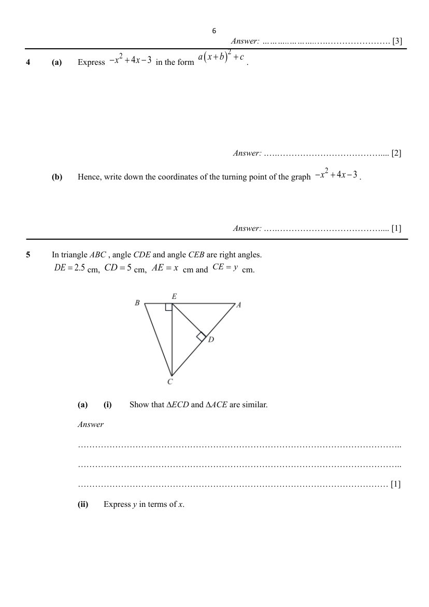
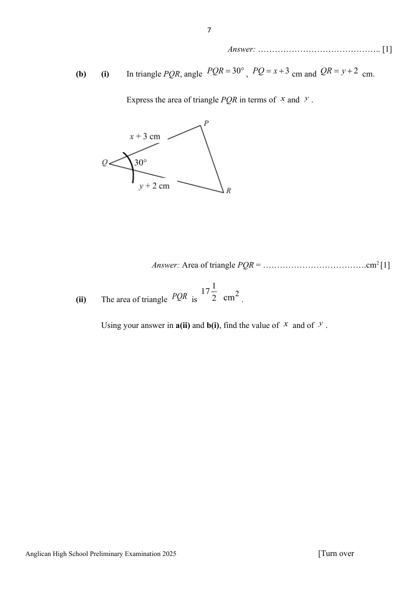

## Question

> **Marks:** (a)(i) [1]; (a)(ii) [1]; (b)(i) [1]; (b)(ii) [3]; total [6]
> **Page:** 6–8

In triangle $ABC$, angle $CDE$ and angle $CEB$ are right angles. $DE=2.5$ cm, $CD=5$ cm, $AE=x$ cm and $CE=y$ cm.

**(a) (i)** Show that $\triangle ECD$ and $\triangle ACE$ are similar. [1]

**(ii)** Express $y$ in terms of $x$. [1]

**(b) (i)** In triangle $PQR$, angle $PQR=30^{\circ}$, $PQ=x+3$ cm and $QR=y+2$ cm.

Express the area of triangle $PQR$ in terms of $x$ and $y$. [1]

**(ii)** The area of triangle $PQR$ is $17\dfrac{1}{2}\ \mathrm{cm}^{2}$.

Using your answer in **(a)(ii)** and **(b)(i)**, find the value of $x$ and of $y$. [3]

## Answer Scheme

In triangle $ABC$, angle $CDE$ and angle $CEB$ are right angles. $DE=2.5$ cm, $CD=5$ cm, $AE=x$ cm and $CE=y$ cm.

**(a) (i)** Show that $\triangle ECD$ and $\triangle ACE$ are similar.

Angle $ECD=$ Angle $ACE$ (common angle).

Angle $EDC=$ Angle $AEC=90^{\circ}$ (given).

By AA test, the 2 triangles are similar.

**B1**

**(ii)** Express $y$ in terms of $x$.

$$
\begin{aligned}
\dfrac{ED}{AE}&=\dfrac{CD}{CE}\\
\dfrac{2.5}{x}&=\dfrac{5}{y}\\
y&=2x
\end{aligned}
$$

**B1**

**(b) (i)** In triangle $PQR$, angle $PQR=30^{\circ}$, $PQ=x+3$ cm and $QR=y+2$ cm.

Express the area of triangle $PQR$ in terms of $x$ and $y$.

$$
\begin{aligned}
\text{Area of }\triangle PQR&=\dfrac{1}{2}(y+2)(x+3)\sin 30^{\circ}\\
&=\dfrac{1}{4}(y+2)(x+3)\ \mathrm{cm}^{2}
\end{aligned}
$$

**B1**

**(ii)** The area of triangle $PQR$ is $17\dfrac{1}{2}\ \mathrm{cm}^{2}$.

Using your answer in **(a)(ii)** and **(b)(i)**, find the value of $x$ and of $y$.

$$
\begin{aligned}
\dfrac{1}{4}(x+3)(y+2)&=17\dfrac{1}{2}\\
\dfrac{1}{4}(x+3)(2x+2)&=\dfrac{35}{2}\\
2x^{2}+8x+6&=70\\
2x^{2}+8x-64&=0\\
x^{2}+4x-32&=0\\
(x-4)(x+8)&=0\\
x&=4\quad\text{or}\quad x=-8\ (\mathrm{NA})
\end{aligned}
$$

When $x=4$,

$$
\begin{aligned}
y&=2(4)\\
&=8
\end{aligned}
$$

**M1** for students to form the quadratic equation. **M1** for solving the quadratic equation. **A1**
