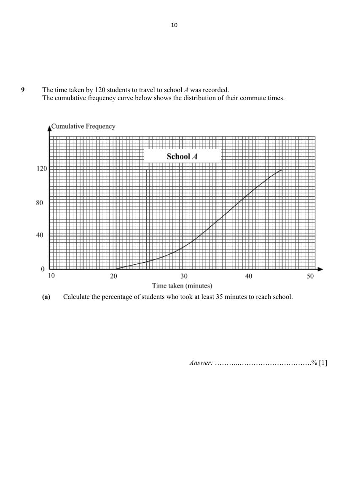
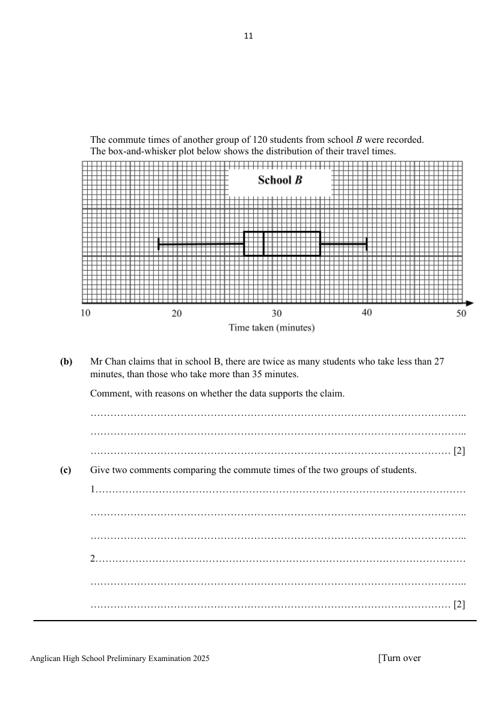

## Question

> **Marks:** (a) [1]; (b) [2]; (c) [2]; total [5]
> **Page:** 10–11

The time taken by 120 students to travel to school $A$ was recorded. The cumulative frequency curve below shows the distribution of their commute times.

**(a)** Calculate the percentage of students who took at least 35 minutes to reach school. [1]

The commute times of another group of 120 students from school $B$ were recorded. The box-and-whisker plot below shows the distribution of their travel times.

**(b)** Mr Chan claims that in school B, there are twice as many students who take less than 27 minutes, than those who take more than 35 minutes.

Comment, with reasons on whether the data supports the claim. [2]

**(c)** Give two comments comparing the commute times of the two groups of students. [2]

## Answer Scheme

The time taken by 120 students to travel to school $A$ was recorded. The cumulative frequency curve below shows the distribution of their commute times.

**(a)** Calculate the percentage of students who took at least 35 minutes to reach school.

$53\dfrac{1}{3}\%$ or $53.3\%$.

**B1**

The commute times of another group of 120 students from school $B$ were recorded. The box-and-whisker plot below shows the distribution of their travel times.

**(b)** Mr Chan claims that in school B, there are twice as many students who take less than 27 minutes, than those who take more than 35 minutes.

Comment, with reasons on whether the data supports the claim.

False.

There are equal numbers of students who took less than 27 mins and students who took more than 35 mins.

**B1** **B1**

**(c)** Give two comments comparing the commute times of the two groups of students.

Median for 1st group $=35.5$ minutes. Median for 2nd group $=29$ minutes. The commute time for the 2nd group is shorter as it has a lower median.

The interquartile range for the first group is 9 minutes while the interquartile range for the second group is 8 minutes. The 2nd group has more consistent commute times as its interquartile range is smaller.

**B1** **B1**
