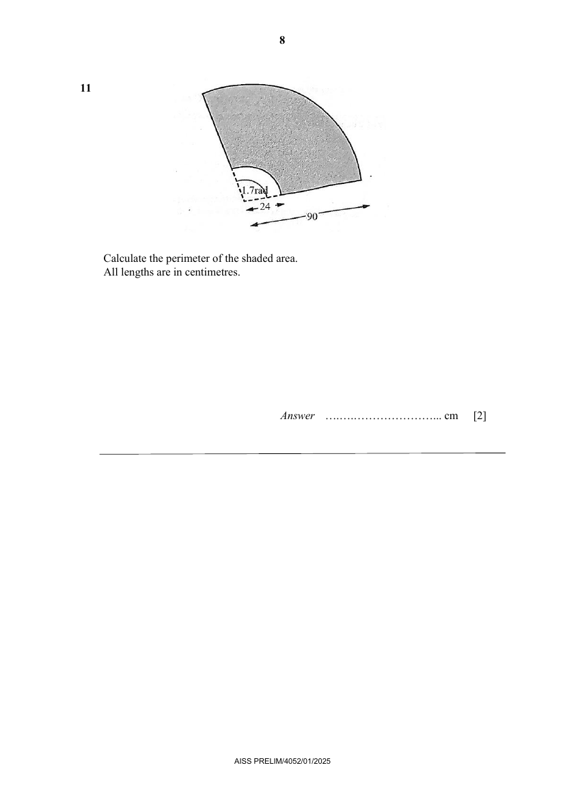

## Question

> **Marks:** 2
> **Page:** 8

Calculate the perimeter of the shaded area.
All lengths are in centimetres. [2]

## Answer Scheme

Calculate the perimeter of the shaded area. All lengths are in centimetres.

$$
\text{Perimeter of shaded area}=1.7\times 24+1.7\times 90+2(66)
$$

M1 for setting up the equation correctly.

$$
=325.8\text{ cm}
$$

A1, exact so do not accept 3 s.f. answer.
