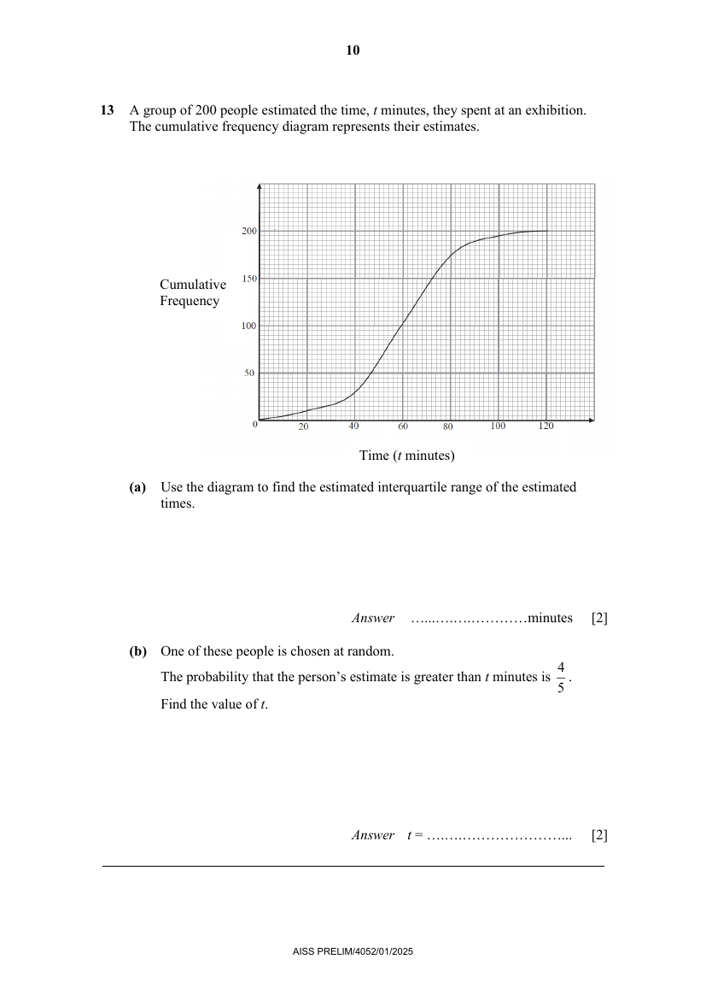

## Question

> **Marks:** (a) 2, (b) 2; total 4
> **Page:** 10

A group of 200 people estimated the time, $t$ minutes, they spent at an exhibition.
The cumulative frequency diagram represents their estimates.

**(a)** Use the diagram to find the estimated interquartile range of the estimated times. [2]

**(b)** One of these people is chosen at random.
The probability that the person's estimate is greater than $t$ minutes is $\dfrac{4}{5}$.
Find the value of $t$. [2]

## Answer Scheme

**(a)** Use the diagram to find the estimated interquartile range of the estimated times.

$$
\text{Interquartile range}=72-47=25\text{ minutes}
$$

M1 for finding the upper quartile and lower quartile. A1.

**(b)** One of these people is chosen at random. The probability that the person's estimate is greater than $t$ minutes is $\dfrac{4}{5}$. Find the value of $t$.

Probability of a person's estimate less than or equal to $t$ minutes is $\dfrac{1}{5}$.

Number of people $=40$.

From graph, $t=44$.

M1 for $40$. A1.
