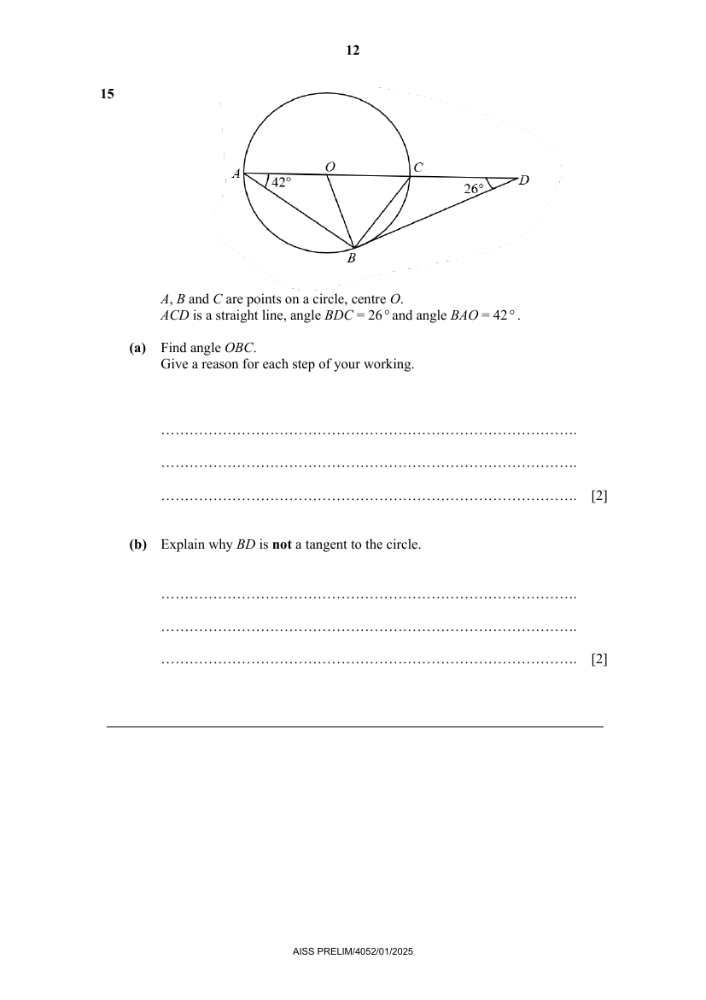

## Question

> **Marks:** (a) 2, (b) 2; total 4
> **Page:** 12

$A$, $B$ and $C$ are points on a circle, centre $O$.
$ACD$ is a straight line, angle $BDC=26^{\circ}$ and angle $BAO=42^{\circ}$.

**(a)** Find angle $OBC$.
Give a reason for each step of your working. [2]

**(b)** Explain why $BD$ is not a tangent to the circle. [2]

## Answer Scheme

**(a)** Find angle $OBC$. Give a reason for each step of your working.

Minus 1 mark if no mention of radii or radius of circle.

$OA=OB$ (radii of a circle).

$\angle OBA=42^{\circ}$ (base angle of isosceles triangle $OAB$).

$\angle ABC=90^{\circ}$ (angle in a semicircle).

$$
\angle OBC=90^{\circ}-42^{\circ}=48^{\circ}
$$

M1 for finding either angle $OBA$ or angle $ABC$. A1.

**(b)** Explain why $BD$ is not a tangent to the circle.

$\angle BOC=84^{\circ}$ (exterior angle of isosceles triangle $OBC$).

$$
\angle OBD=180^{\circ}-84^{\circ}-26^{\circ}=70^{\circ}
$$

(sum of angles in a triangle). M1 for finding angle $OBD$.

Since $\angle OBD\neq 90^{\circ}$, therefore by the converse of the radius perpendicular to tangent, $BD$ is not a tangent to the circle.

A1 stating it is not $90^{\circ}$ with (by converse) tangent perpendicular to a radius.

Alternative solution.

$\angle BOC=84^{\circ}$ (angle at centre $= 2 \times$ angle at circumference). M1 for finding angle $OBD$.

$$
\angle OBD=180^{\circ}-84^{\circ}-26^{\circ}=70^{\circ}
$$

(sum of angles in a triangle).

Since $\angle OBD\neq 90^{\circ}$, therefore by the converse of the radius perpendicular to tangent, $BD$ is not a tangent to the circle.

A1 stating it is not $90^{\circ}$ with (by converse) tangent perpendicular to a radius.
