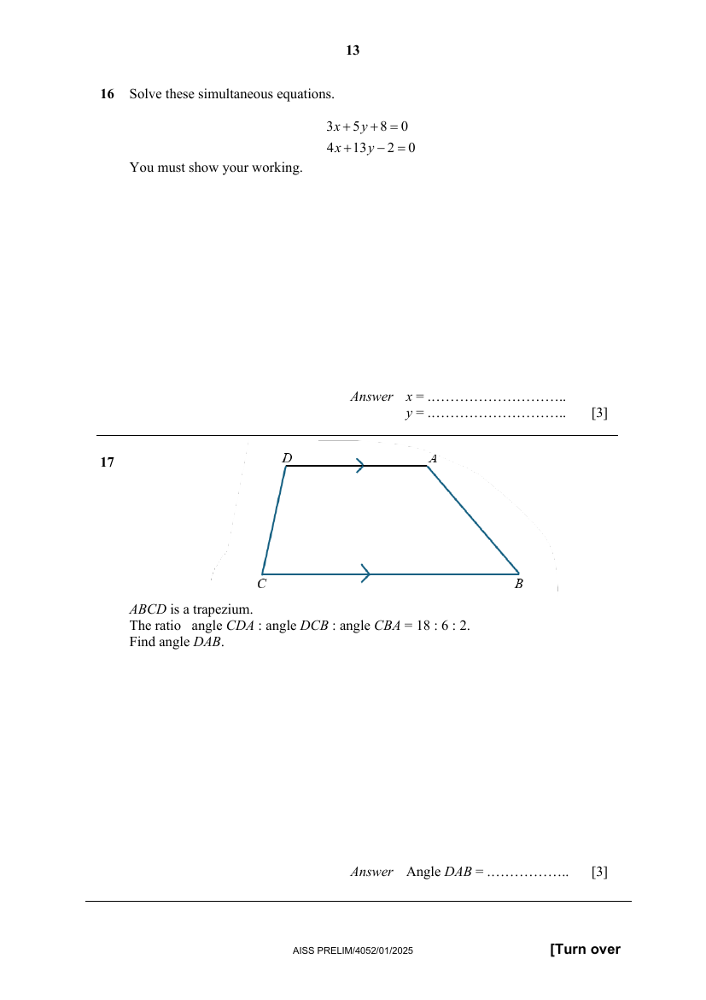

## Question

> **Marks:** 3
> **Page:** 13

$ABCD$ is a trapezium.
The ratio angle $CDA$ : angle $DCB$ : angle $CBA$ $= 18:6:2$.
Find angle $DAB$. [3]

## Answer Scheme

$ABCD$ is a trapezium. The ratio angle $CDA$ : angle $DCB$ : angle $CBA$ $= 18:6:2$. Find angle $DAB$.

$24$ units represent $180^{\circ}$. M1 for recognising that angle $CDA$ and angle $DCB$ are interior angles. It is good practice to write the angle reasoning so that markers understand your work.

$1$ unit represents $7.5^{\circ}$.

$2$ units represent $15^{\circ}$.

$$
\angle DAB=180^{\circ}-15^{\circ}=165^{\circ}
$$

(interior angles). M1 for either applying interior angles or the sum of angles in a quadrilateral correctly. A1.

Note: Answer mark is deducted if there is no clear indication of the unit of measure used throughout the entire working.
