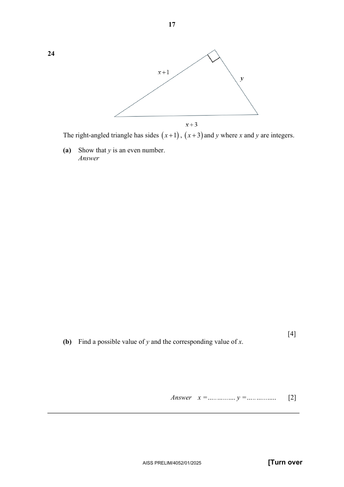

## Question

> **Marks:** (a) 4, (b) 2; total 6
> **Page:** 17

The right-angled triangle has sides $(x+1)$, $(x+3)$ and $y$ where $x$ and $y$ are integers.

**(a)** Show that $y$ is an even number. [4]

**(b)** Find a possible value of $y$ and the corresponding value of $x$. [2]

## Answer Scheme

The right-angled triangle has sides $(x+1)$, $(x+3)$ and $y$ where $x$ and $y$ are integers.

**(a)** Show that $y$ is an even number.

$$
y^{2}=(x+3)^{2}-(x+1)^{2}
$$

M1 for setting up the correct equation.

$$
=x^{2}+6x+9-(x^{2}+2x+1)=4x+8=4(x+2)
$$

M1 for correct expansion, or for applying the difference of squares to reach $4x+8$.

Since $4$ is even, multiplying it by $(x+2)$, an integer, will make $y^{2}$ even. Taking the square root of an even number gives an even number. Therefore $y$ is even (shown).

M1 for convincingly establishing $y^{2}$ is even. A1 for stating that the square root of an even number must be even and concluding for $y$.

Or

$$
y^{2}=4(x+2)
$$

$$
y=2\sqrt{x+2}
$$

Since $y$ is an integer, $\sqrt{x+2}$ must be an integer. As such, $2$ is a factor of $y$, therefore $y$ is even.

M1 for correct $y^{2}$. A1 for stating that $\sqrt{x+2}$ is an integer and therefore $2$ is a factor, with a proper conclusion for $y$.

**(b)** Find a possible value of $y$ and the corresponding value of $x$.

Let $y^{2}=16$, so $y=4$.

Hence $4x+8=16$, so $x=2$.

B1: accept any logical $y$, where $y^{2}$ is a multiple of $4$. B1 for the corresponding $x$.
