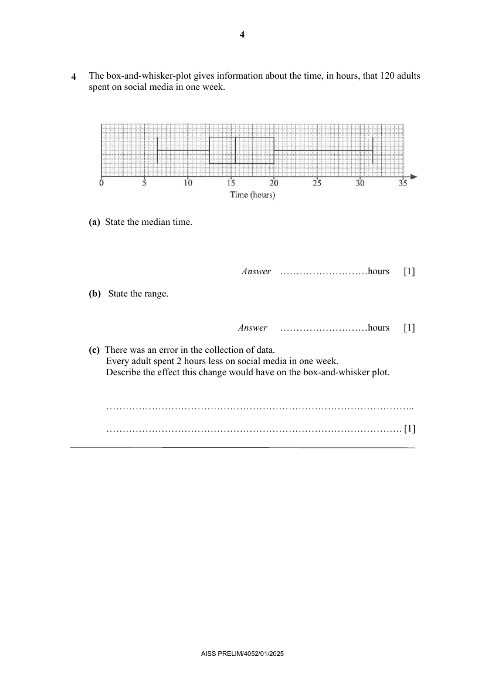

## Question

> **Marks:** (a) 1, (b) 1, (c) 1; total 3
> **Page:** 4

The box-and-whisker-plot gives information about the time, in hours, that 120 adults spent on social media in one week.

**(a)** State the median time. [1]

**(b)** State the range. [1]

**(c)** There was an error in the collection of data.
Every adult spent 2 hours less on social media in one week.
Describe the effect this change would have on the box-and-whisker plot. [1]

## Answer Scheme

**(a)** State the median time.

$15.5$ hours. B1.

**(b)** State the range.

$$
\text{Range}=31.5-6.5=25
$$

B1.

**(c)** There was an error in the collection of data. Every adult spent 2 hours less on social media in one week. Describe the effect this change would have on the box-and-whisker plot.

The whole box-and-whisker plot will move to the left by 4 square units.

B1 all key words must be present.
