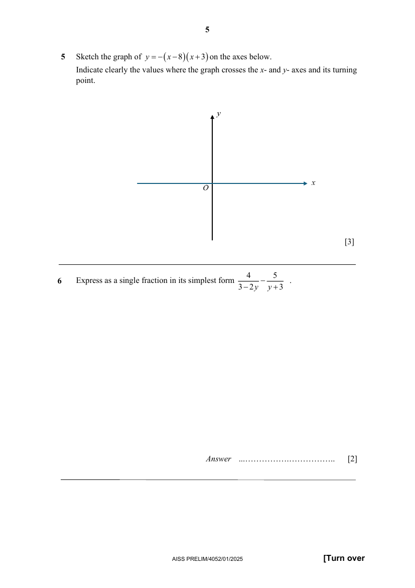

## Question

> **Marks:** 3
> **Page:** 5

Sketch the graph of $y=-(x-8)(x+3)$ on the axes below.
Indicate clearly the values where the graph crosses the $x$- and $y$-axes and its turning point. [3]

## Answer Scheme

Sketch the graph of $y=-(x-8)(x+3)$ on the axes below. Indicate clearly the values where the graph crosses the $x$- and $y$-axes.

Coordinates of turning point $(2.5,\ 30.25)$.

B1 correct shape and $y$-intercept. B1 correct turning point. B1 correct $x$-intercepts.
