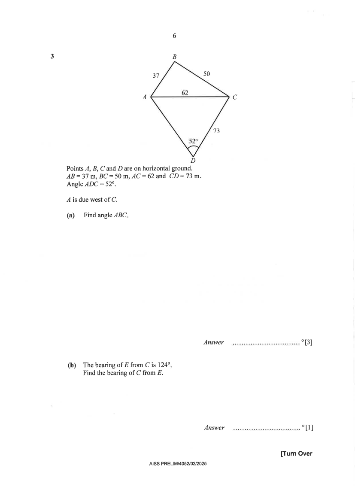

## Question

> **Marks:** (a) 3, (b) 1, (c) 3, (d) 3; total 10
> **Page:** 6–7

Points $A$, $B$, $C$ and $D$ are on horizontal ground.
$AB=37$ m, $BC=50$ m, $AC=62$ m and $CD=73$ m.
Angle $ADC=52^{\circ}$.

$A$ is due west of $C$.

**(a)** Find angle $ABC$. [3]

**(b)** The bearing of $E$ from $C$ is $124^{\circ}$.
Find the bearing of $C$ from $E$. [1]

**(c)** Find the bearing of $D$ from $A$. [3]

**(d)** Point $C$ is the base of a vertical flagpole $CF$.
The angle of elevation of $F$ from $B$ is $8^{\circ}$.

Calculate the angle of elevation of $F$ from $D$. [3]

## Answer Scheme

**(a)** Cosine rule.

$$
62^{2}=37^{2}+50^{2}-2(37)(50)\cos\angle ABC
$$

M1 for correct substitution of values into the cosine rule.

$$
\cos\angle ABC=\frac{62^{2}-37^{2}-50^{2}}{-2(37)(50)}
$$

$$
\angle ABC=\cos^{-1}\left(\frac{62^{2}-37^{2}-50^{2}}{-2(37)(50)}\right)=89.6^{\circ}\ (1\text{ d.p.})
$$

M1 for rearranging and making $\angle ABC$ the subject. A1.

**(b)** Method 1: interior angles.

$$
180^{\circ}-124^{\circ}=56^{\circ}
$$

(interior angles, parallel lines).

$$
360^{\circ}-56^{\circ}=304^{\circ}
$$

(angles at a point). B1 for $304^{\circ}$. Angle properties not required.

Method 2: $180^{\circ}+124^{\circ}=304^{\circ}$.

**(c)** Sine rule.

$$
\frac{\sin\angle CAD}{73}=\frac{\sin 52^{\circ}}{62}
$$

M1 for substituting the values correctly into the sine rule.

$$
\sin\angle CAD=\frac{73\sin 52^{\circ}}{62}
$$

$$
\angle CAD=\sin^{-1}\left(\frac{73\sin 52^{\circ}}{62}\right)
$$

M1 for rearranging and finding $\angle CAD$.

Let the north of $A$ be $N$. Since $A$ is due west of $C$, $\angle NAC=90^{\circ}$.

Bearing of $D$ from $A$

$$
=90^{\circ}+\sin^{-1}\left(\frac{73\sin 52^{\circ}}{62}\right)=158.1^{\circ}\ (1\text{ d.p.})
$$

A1.

**(d)**

$$
\tan 8^{\circ}=\frac{CF}{50},\quad CF=50\tan 8^{\circ}
$$

M1 to find the correct height of the flagpole.

$$
\tan\angle FDC=\frac{50\tan 8^{\circ}}{73}
$$

$$
\angle FDC=\tan^{-1}\left(\frac{50\tan 8^{\circ}}{73}\right)=5.5^{\circ}\ (1\text{ d.p.})
$$

M1 for the correct equation involving $\angle FDC$ and $CF$. A1.
