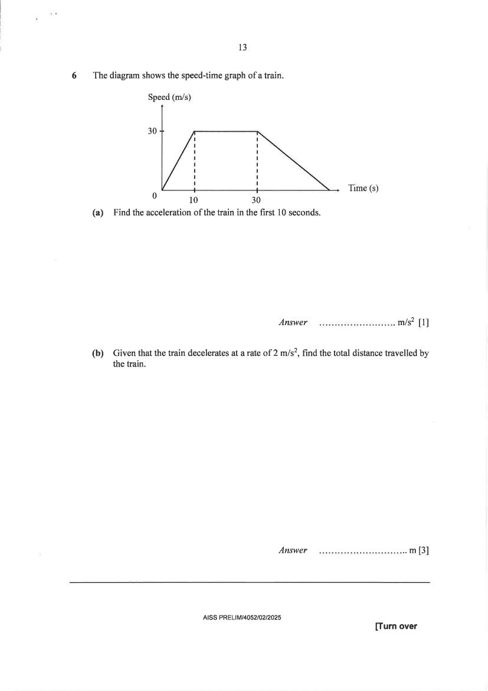

## Question

> **Marks:** (a) 1, (b) 3; total 4
> **Page:** 13

The diagram shows the speed-time graph of a train.

**(a)** Find the acceleration of the train in the first $10$ seconds. [1]

**(b)** Given that the train decelerates at a rate of $2$ m/s$^{2}$, find the total distance travelled by the train. [3]

## Answer Scheme

**(a)**

$$
\frac{30}{10}=3\text{ m/s}^{2}
$$

B1.

**(b)** Duration of deceleration $=\dfrac{30}{2}=15$ s. Total time $=45$ s.

M1 for finding the correct total time of the journey, $45$ s.

Method 2: $\dfrac{30-0}{t-30}=2$, so $t=45$.

$$
\text{Total distance}=\frac{1}{2}(20+45)(30)=975\text{ km}
$$

M1 for the area of the trapezium. A1.
