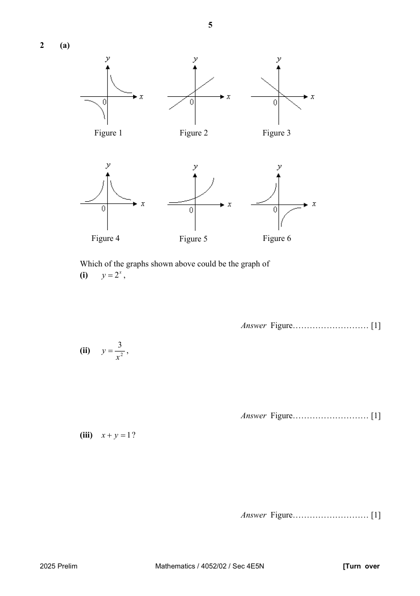
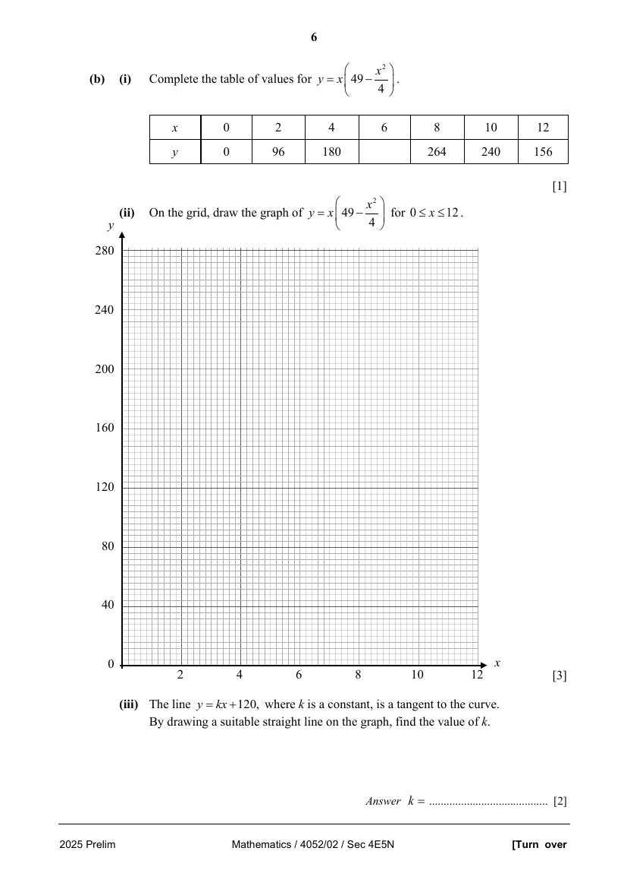

## Question

> **Marks:** (a)(i) 1, (a)(ii) 1, (a)(iii) 1, (b)(i) 1, (b)(ii) 3, (b)(iii) 2; total 9
> **Page:** 5–6

**(a)**

Which of the graphs shown above could be the graph of

**(i)** $y=2^{x}$, [1]

**(ii)** $y=\dfrac{3}{x^{2}}$, [1]

**(iii)** $x+y=1$? [1]

**(b)** **(i)** Complete the table of values for $y=x\left(49-\dfrac{x^{2}}{4}\right)$. [1]

| $x$ | 0 | 2 | 4 | 6 | 8 | 10 | 12 |
| --- | --- | --- | --- | --- | --- | --- | --- |
| $y$ | 0 | 96 | 180 |  | 264 | 240 | 156 |

**(ii)** On the grid, draw the graph of $y=x\left(49-\dfrac{x^{2}}{4}\right)$ for $0 \leq x \leq 12$. [3]

**(iii)** The line $y=kx+120$, where $k$ is a constant, is a tangent to the curve.
By drawing a suitable straight line on the graph, find the value of $k$. [2]

## Answer Scheme

**(a)**

Which of the graphs shown above could be the graph of

**(i)** $y=2^{x}$, [1]

**(ii)** $y=\dfrac{3}{x^{2}}$, [1]

**(iii)** $x+y=1$? [1]

**(b)** **(i)** Complete the table of values for $y=x\left(49-\dfrac{x^{2}}{4}\right)$. [1]

| $x$ | 0 | 2 | 4 | 6 | 8 | 10 | 12 |
| --- | --- | --- | --- | --- | --- | --- | --- |
| $y$ | 0 | 96 | 180 |  | 264 | 240 | 156 |

**(ii)** On the grid, draw the graph of $y=x\left(49-\dfrac{x^{2}}{4}\right)$ for $0 \leq x \leq 12$. [3]

**(iii)** The line $y=kx+120$, where $k$ is a constant, is a tangent to the curve.
By drawing a suitable straight line on the graph, find the value of $k$. [2]
