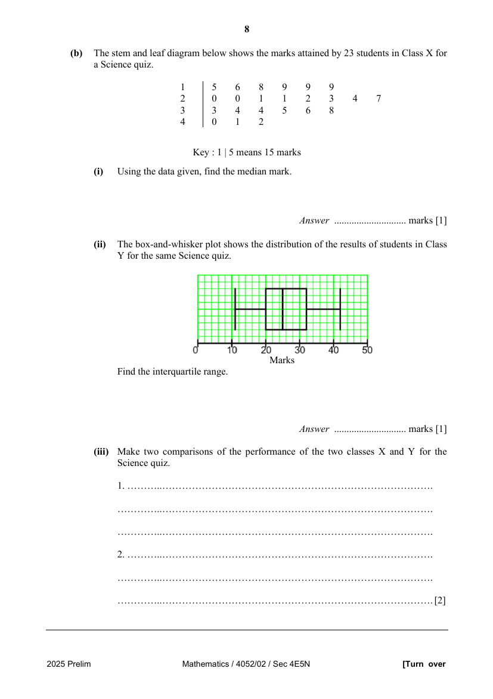

## Question

> **Marks:** (a)(i)(a) 2, (a)(i)(b) 2, (a)(ii) 2, (a)(iii) 1, (b)(i) 1, (b)(ii) 1, (b)(iii) 2; total 11
> **Page:** 7–8

**(a)** A packet contains a large number of flower seeds that produce white, yellow or red flowers. Half of the seeds produce white flowers and one third produce yellow flowers. The remainder of the seeds produce red flowers.

**(i)** Two seeds are chosen at random. Find the probability that

**(a)** one will produce a yellow flower and one will produce a white flower, [2]

**(b)** neither will produce a red flower. [2]

**(ii)** Three seeds are chosen at random. Find the probability that at most two seeds will produce white flowers. [2]

**(iii)** Given that $n$ seeds are chosen at random, find the probability that all the seeds will produce red flowers. [1]

**(b)** The stem and leaf diagram below shows the marks attained by 23 students in Class X for a Science quiz.

| Stem | Leaf |  |  |  |  |  |  |  |
| --- | --- | --- | --- | --- | --- | --- | --- | --- |
| 1 | 5 | 6 | 8 | 9 | 9 | 9 |  |  |
| 2 | 0 | 0 | 1 | 1 | 2 | 3 | 4 | 7 |
| 3 | 3 | 4 | 4 | 5 | 6 | 8 |  |  |
| 4 | 0 | 1 | 2 |  |  |  |  |  |

Key: $1 \mid 5$ means 15 marks.

**(i)** Using the data given, find the median mark. [1]

**(ii)** The box-and-whisker plot shows the distribution of the results of students in Class Y for the same Science quiz.

Find the interquartile range. [1]

**(iii)** Make two comparisons of the performance of the two classes X and Y for the Science quiz. [2]

## Answer Scheme

**(a)** A packet contains a large number of flower seeds that produce white, yellow or red flowers. Half of the seeds produce white flowers and one third produce yellow flowers. The remainder of the seeds produce red flowers.

**(i)** Two seeds are chosen at random. Find the probability that

**(a)** one will produce a yellow flower and one will produce a white flower, [2]

**(b)** neither will produce a red flower. [2]

**(ii)** Three seeds are chosen at random. Find the probability that at most two seeds will produce white flowers. [2]

**(iii)** Given that $n$ seeds are chosen at random, find the probability that all the seeds will produce red flowers. [1]

**(b)** The stem and leaf diagram below shows the marks attained by 23 students in Class X for a Science quiz.

| Stem | Leaf |  |  |  |  |  |  |  |
| --- | --- | --- | --- | --- | --- | --- | --- | --- |
| 1 | 5 | 6 | 8 | 9 | 9 | 9 |  |  |
| 2 | 0 | 0 | 1 | 1 | 2 | 3 | 4 | 7 |
| 3 | 3 | 4 | 4 | 5 | 6 | 8 |  |  |
| 4 | 0 | 1 | 2 |  |  |  |  |  |

Key: $1 \mid 5$ means 15 marks.

**(i)** Using the data given, find the median mark. [1]

**(ii)** The box-and-whisker plot shows the distribution of the results of students in Class Y for the same Science quiz.

Find the interquartile range. [1]

**(iii)** Make two comparisons of the performance of the two classes X and Y for the Science quiz. [2]
