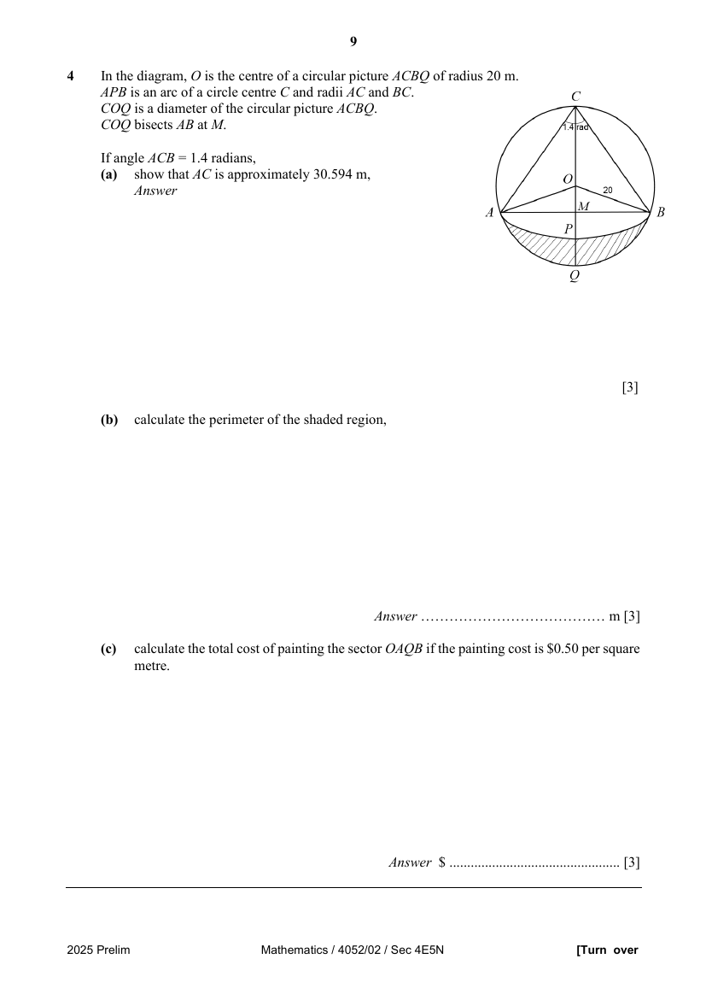

## Question

> **Marks:** (a) 3, (b) 3, (c) 3; total 9
> **Page:** 9

In the diagram, $O$ is the centre of a circular picture $ACBQ$ of radius $20\text{ m}$.
$APB$ is an arc of a circle centre $C$ and radii $AC$ and $BC$.
$COQ$ is a diameter of the circular picture $ACBQ$.
$COQ$ bisects $AB$ at $M$.

If angle $ACB = 1.4$ radians,

**(a)** show that $AC$ is approximately $30.594\text{ m}$, [3]

**(b)** calculate the perimeter of the shaded region, [3]

**(c)** calculate the total cost of painting the sector $OAQB$ if the painting cost is SGD 0.50 per square metre. [3]

## Answer Scheme

In the diagram, $O$ is the centre of a circular picture $ACBQ$ of radius $20\text{ m}$.
$APB$ is an arc of a circle centre $C$ and radii $AC$ and $BC$.
$COQ$ is a diameter of the circular picture $ACBQ$.
$COQ$ bisects $AB$ at $M$.

If angle $ACB = 1.4$ radians,

**(a)** show that $AC$ is approximately $30.594\text{ m}$, [3]

**(b)** calculate the perimeter of the shaded region, [3]

**(c)** calculate the total cost of painting the sector $OAQB$ if the painting cost is SGD 0.50 per square metre. [3]
