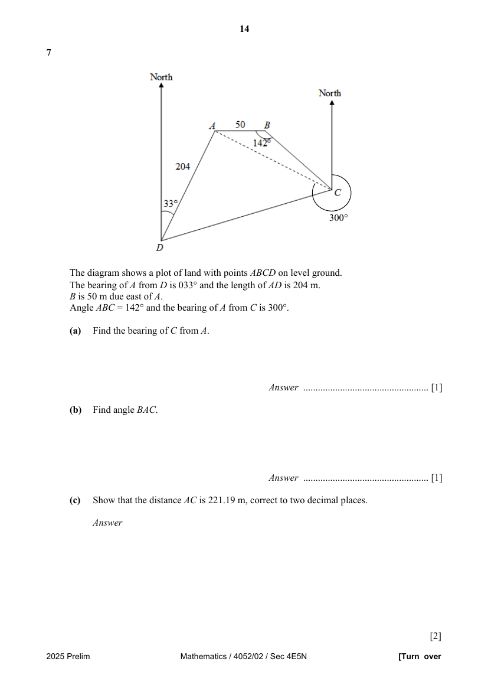

## Question

> **Marks:** (a) 1, (b) 1, (c) 2, (d) 2, (e) 1, (f) 3, (g) 2; total 12
> **Page:** 14–15

The diagram shows a plot of land with points $ABCD$ on level ground.
The bearing of $A$ from $D$ is $033^{\circ}$ and the length of $AD$ is $204\text{ m}$.
$B$ is $50\text{ m}$ due east of $A$.
Angle $ABC = 142^{\circ}$ and the bearing of $A$ from $C$ is $300^{\circ}$.

**(a)** Find the bearing of $C$ from $A$. [1]

**(b)** Find angle $BAC$. [1]

**(c)** Show that the distance $AC$ is $221.19\text{ m}$, correct to two decimal places. [2]

**(d)** Find the area of triangle $ABC$. [2]

**(e)** Find angle $DAC$. [1]

**(f)** Hence, calculate the distance $DC$. [3]

**(g)** A tree, $15\text{ m}$ tall, stands vertically at $A$.
Find the angle of elevation of the top of the tree from $D$. [2]

## Answer Scheme

The diagram shows a plot of land with points $ABCD$ on level ground.
The bearing of $A$ from $D$ is $033^{\circ}$ and the length of $AD$ is $204\text{ m}$.
$B$ is $50\text{ m}$ due east of $A$.
Angle $ABC = 142^{\circ}$ and the bearing of $A$ from $C$ is $300^{\circ}$.

**(a)** Find the bearing of $C$ from $A$. [1]

**(b)** Find angle $BAC$. [1]

**(c)** Show that the distance $AC$ is $221.19\text{ m}$, correct to two decimal places. [2]

**(d)** Find the area of triangle $ABC$. [2]

**(e)** Find angle $DAC$. [1]

**(f)** Hence, calculate the distance $DC$. [3]

**(g)** A tree, $15\text{ m}$ tall, stands vertically at $A$.
Find the angle of elevation of the top of the tree from $D$. [2]
