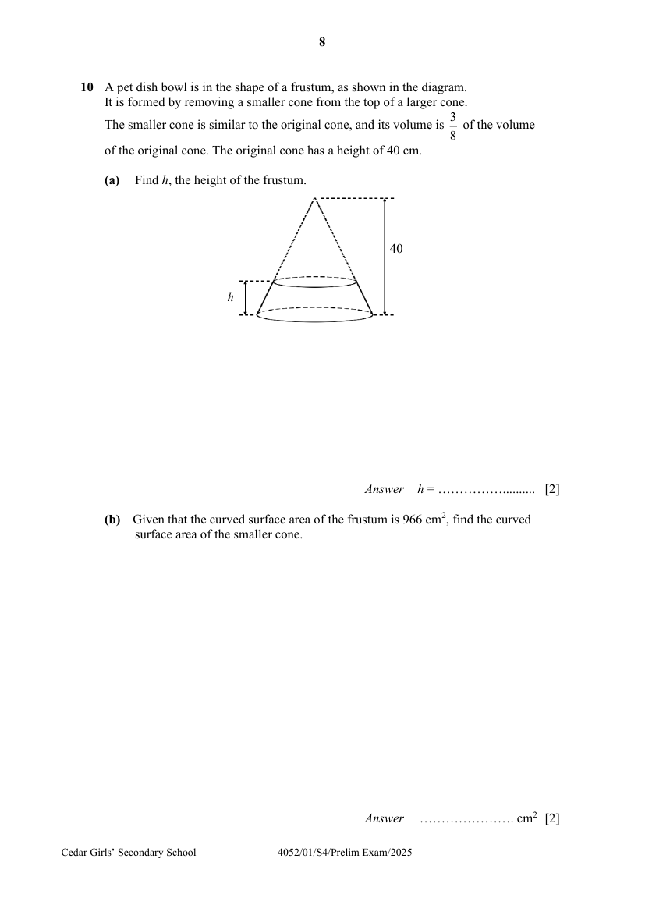

## Question

> **Marks:** (a) 2, (b) 2; total 4
> **Page:** 8

A pet dish bowl is in the shape of a frustum, as shown in the diagram.
It is formed by removing a smaller cone from the top of a larger cone.
The smaller cone is similar to the original cone, and its volume is $\dfrac{3}{8}$ of the volume of the original cone. The original cone has a height of $40\text{ cm}$.

**(a)** Find $h$, the height of the frustum. [2]

**(b)** Given that the curved surface area of the frustum is $966\text{ cm}^{2}$, find the curved surface area of the smaller cone. [2]

## Answer Scheme

**(a)** Find $h$, the height of the frustum.

$$
\sqrt[3]{\frac{3}{8}} = \frac{40-h}{40}
$$

(using cube root)

$$
h = 40-40\times\sqrt[3]{\frac{3}{8}}
$$

$$
h = 11.2
$$

($3$ s.f.)

**(b)** Given that the curved surface area of the frustum is $966\text{ cm}^{2}$, find the curved surface area of the smaller cone.

$$
\frac{A_{\text{smaller cone}}}{A_{\text{larger cone}}} = \left(\sqrt[3]{\frac{3}{8}}\right)^{2}
$$

(squaring the ratio of lengths)

$$
\frac{A_{\text{smaller cone}}}{A_{\text{smaller cone}}+966} = \left(\sqrt[3]{\frac{3}{8}}\right)^{2}
$$

$$
A_{\text{smaller cone}} = \frac{\left(\sqrt[3]{\dfrac{3}{8}}\right)^{2}(966)}{1-\left(\sqrt[3]{\dfrac{3}{8}}\right)^{2}} = 1050\text{ cm}^{2}
$$

($3$ s.f.)
