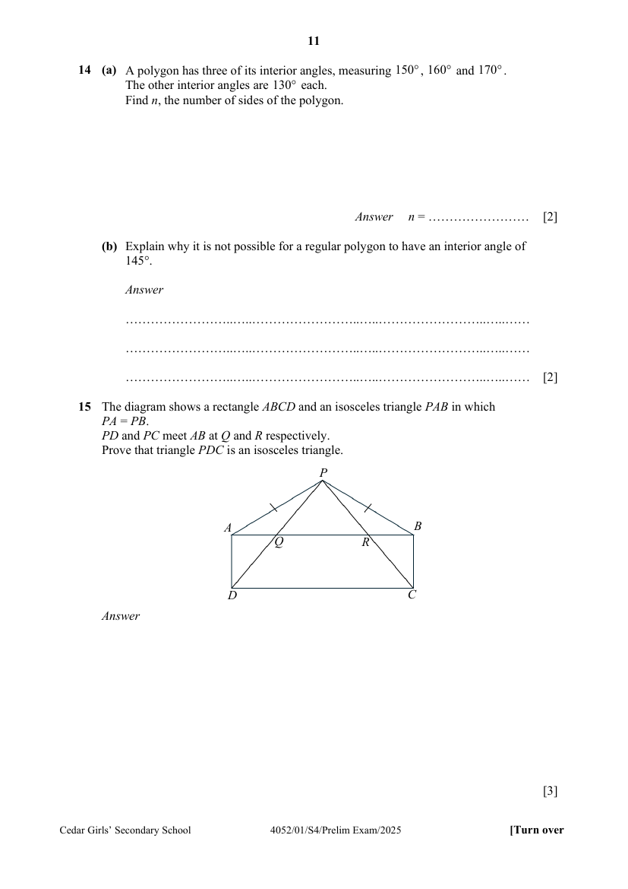

## Question

> **Marks:** 3
> **Page:** 11

The diagram shows a rectangle $ABCD$ and an isosceles triangle $PAB$ in which $PA = PB$.
$PD$ and $PC$ meet $AB$ at $Q$ and $R$ respectively.
Prove that triangle $PDC$ is an isosceles triangle. [3]

## Answer Scheme

The diagram shows a rectangle $ABCD$ and an isosceles triangle $PAB$ in which $PA = PB$. $PD$ and $PC$ meet $AB$ at $Q$ and $R$ respectively. Prove that triangle $PDC$ is an isosceles triangle.

$PA = PB$ (given) (S)

$AD = BC$ (opp. sides of rectangle) (S)

$\angle PAB = \angle PBA$ (base angles of isosceles triangle)

$$
\begin{aligned}
\angle PAD &= \angle PAB+90^{\circ} \\
&= \angle PBA+90^{\circ} \\
&= \angle PBC
\end{aligned}
$$

(A) (finding $\angle PAD = \angle PBC$)

Therefore, triangle $PAD \equiv$ triangle $PBC$ (SAS)

$\therefore PD = PC$, triangle is an isosceles triangle.
