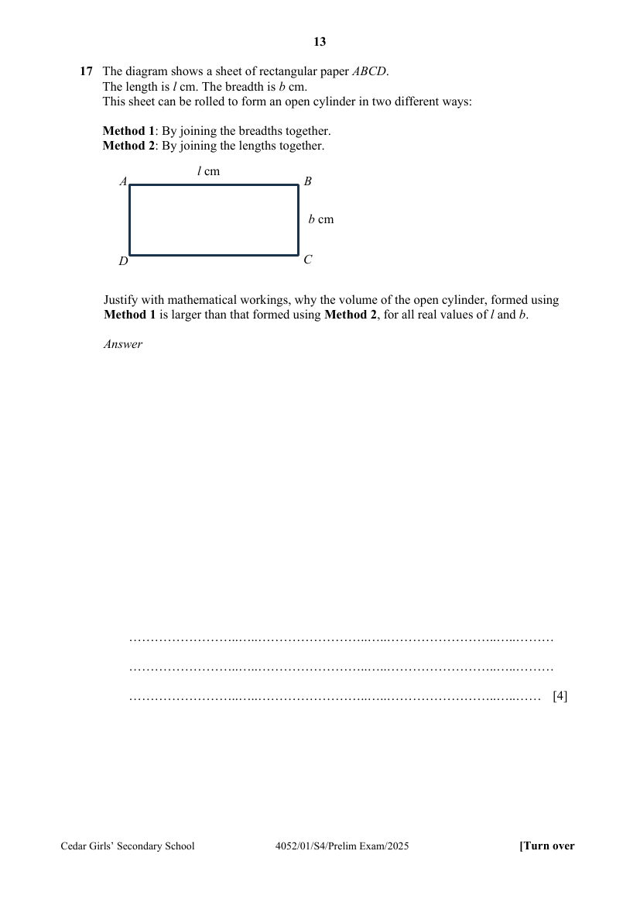

## Question

> **Marks:** 4
> **Page:** 13

The diagram shows a sheet of rectangular paper $ABCD$.
The length is $l\text{ cm}$. The breadth is $b\text{ cm}$.
This sheet can be rolled to form an open cylinder in two different ways:

Method 1: By joining the breadths together.
Method 2: By joining the lengths together.

Justify with mathematical workings, why the volume of the open cylinder, formed using Method 1 is larger than that formed using Method 2, for all real values of $l$ and $b$. [4]

## Answer Scheme

Justify with mathematical workings, why the volume of the open cylinder, formed using Method 1 is larger than that formed using Method 2, for all real values of $l$ and $b$.

| | Method 1 | Method 2 |
| --- | --- | --- |
| Finding radius | $2\pi r_{1} = l$, $r_{1} = \dfrac{l}{2\pi}$ | $2\pi r_{2} = b$, $r_{2} = \dfrac{b}{2\pi}$ |
| Volume | $\pi\left(\dfrac{l}{2\pi}\right)^{2}\times b = \dfrac{bl^{2}}{4\pi}$ | $\pi\left(\dfrac{b}{2\pi}\right)^{2}\times l = \dfrac{b^{2}l}{4\pi}$ |

(Correct radii for both) (Finding volume)

Since $l > b$,

$$
\frac{bl^{2}}{4\pi} > \frac{b^{2}l}{4\pi}
$$

(follow through from above)

Alternatively,

$$
\left(\frac{bl}{4\pi}\right)l > \left(\frac{bl}{4\pi}\right)b
$$

the volume from method 1 is larger.
