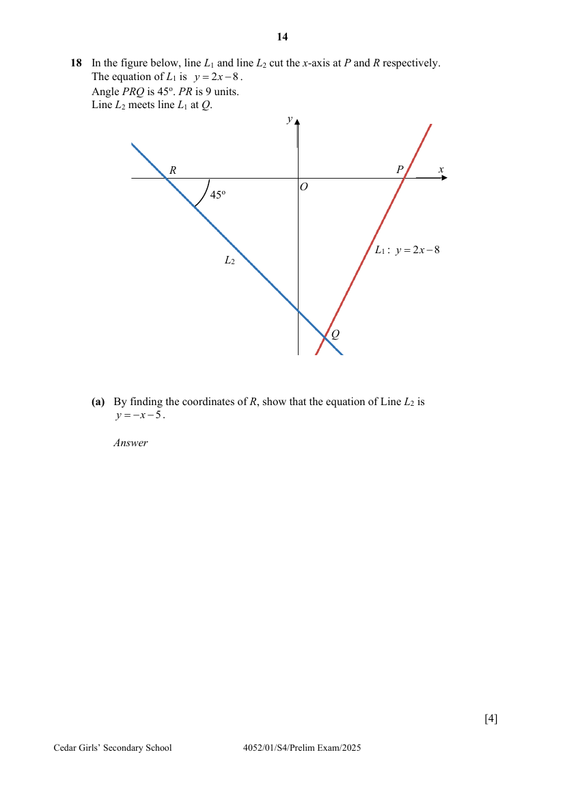

## Question

> **Marks:** (a) 4, (b) 2, (c) 3; total 9
> **Page:** 14–15

In the figure below, line $L_{1}$ and line $L_{2}$ cut the $x$-axis at $P$ and $R$ respectively.
The equation of $L_{1}$ is $y = 2x-8$.
Angle $PRQ$ is $45^{\circ}$. $PR$ is $9$ units.
Line $L_{2}$ meets line $L_{1}$ at $Q$.

**(a)** By finding the coordinates of $R$, show that the equation of Line $L_{2}$ is $y = -x-5$. [4]

**(b)** Find the coordinates of $Q$. [2]

**(c)** Find the shortest distance from $R$ to line $PQ$. [3]

## Answer Scheme

**(a)** By finding the coordinates of $R$, show that the equation of Line $L_{2}$ is $y = -x-5$.

$$
P = (4, 0)
$$

$$
R = (-5, 0)
$$

$$
\text{Gradient} = -\tan 45^{\circ} = -1
$$

(or other similar methods to find gradient)

Therefore, $y = -x+c$.

At $(-5, 0)$,

$$
0 = 5+c
$$

(connect gradient and a point to find $c$)

$$
c = -5
$$

Therefore, equation of $L_{2}$: $y = -x-5$ (Shown)

**(b)** Find the coordinates of $Q$.

$$
y = 2x-8 \quad (1)
$$

$$
y = -x-5 \quad (2)
$$

$$
(1) = (2)
$$

$$
2x-8 = -x-5
$$

$$
x = 1 \rightarrow y = -6
$$

$$
Q = (1, -6)
$$

**(c)** Find the shortest distance from $R$ to line $PQ$.

$$
\text{Area of triangle} = \frac{1}{2}\times 6\times 9 = 27\text{ units}^{2}
$$

$$
PQ = \sqrt{(4-1)^{2}+(0+6)^{2}} = \sqrt{45}\text{ units}
$$

(finding base of triangle)

$$
\text{Shortest distance} = \frac{27\times 2}{\sqrt{45}} = 8.05\text{ units}
$$

($3$ s.f.)
