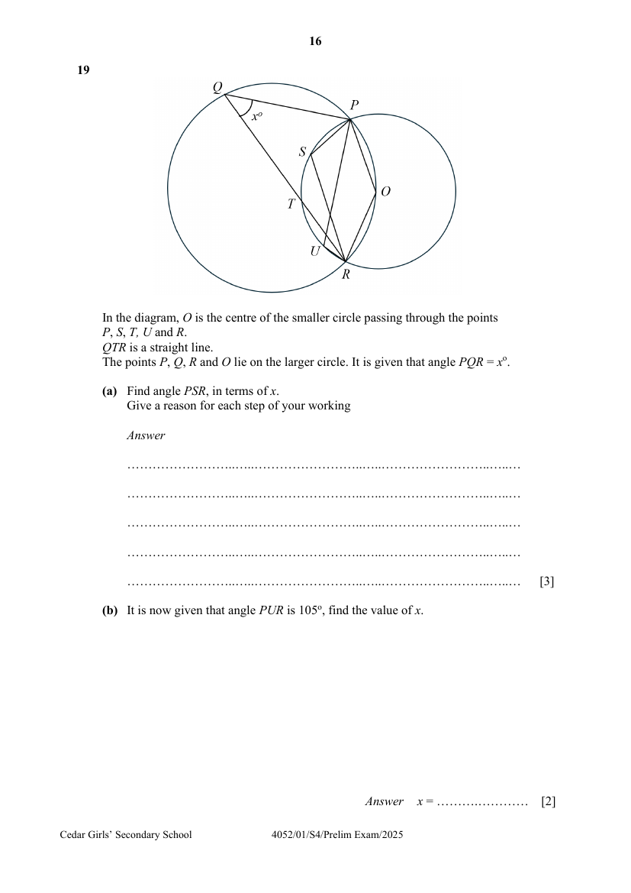

## Question

> **Marks:** (a) 3, (b) 2; total 5
> **Page:** 16

In the diagram, $O$ is the centre of the smaller circle passing through the points $P$, $S$, $T$, $U$ and $R$.
$QTR$ is a straight line.
The points $P$, $Q$, $R$ and $O$ lie on the larger circle. It is given that angle $PQR = x^{\circ}$.

**(a)** Find angle $PSR$, in terms of $x$.
Give a reason for each step of your working [3]

**(b)** It is now given that angle $PUR$ is $105^{\circ}$, find the value of $x$. [2]

## Answer Scheme

**(a)** Find angle $PSR$, in terms of $x$. Give a reason for each step of your working

$$
\angle POR = (180-x)^{\circ}
$$

(angles in opp segments)

$$
\text{reflex }\angle POR = 360^{\circ}-(180-x)^{\circ} = (180+x)^{\circ}
$$

(angles at a pt)

$$
\angle PSR = \frac{(180+x)^{\circ}}{2}
$$

(angle at centre $= 2\times$ angle at circumference)

(also accept $\left(90+\dfrac{x}{2}\right)^{\circ}$)

**(b)** It is now given that angle $PUR$ is $105^{\circ}$, find the value of $x$.

$$
\angle PUR = \frac{(180+x)^{\circ}}{2}
$$

(angles in the same segment)

$$
105 = \frac{180+x}{2}
$$

$$
x = 30
$$
