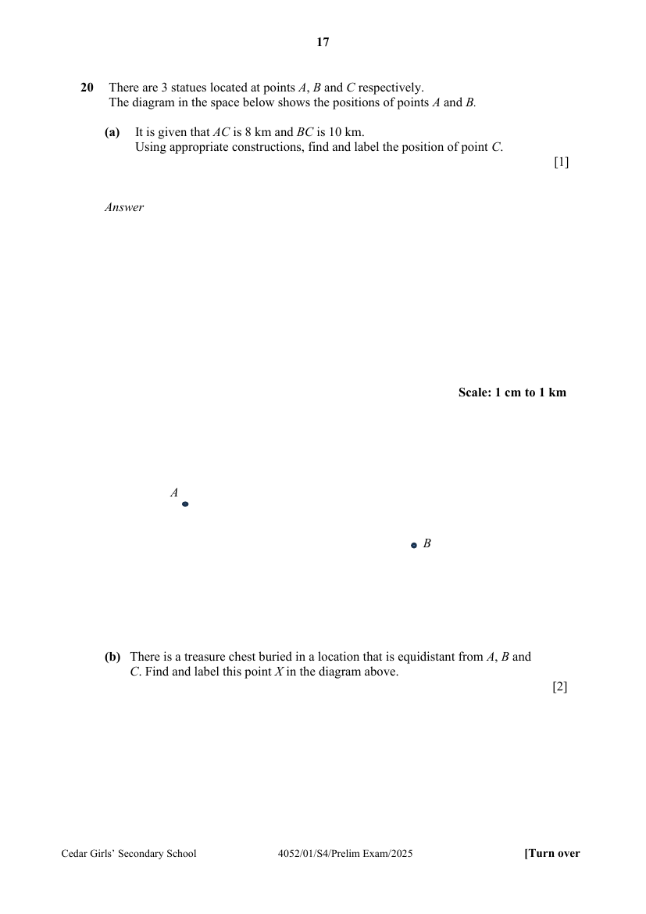

## Question

> **Marks:** (a) 1, (b) 2; total 3
> **Page:** 17

There are $3$ statues located at points $A$, $B$ and $C$ respectively.
The diagram in the space below shows the positions of points $A$ and $B$.

**(a)** It is given that $AC$ is $8\text{ km}$ and $BC$ is $10\text{ km}$.
Using appropriate constructions, find and label the position of point $C$. [1]

**(b)** There is a treasure chest buried in a location that is equidistant from $A$, $B$ and $C$. Find and label this point $X$ in the diagram above. [2]

## Answer Scheme

**(a)** It is given that $AC$ is $8\text{ km}$ and $BC$ is $10\text{ km}$. Using appropriate constructions, find and label the position of point $C$.

Draw $2$ arcs. Find $C$, the intersection of the $2$ arcs.

**(b)** There is a treasure chest buried in a location that is equidistant from $A$, $B$ and $C$. Find and label this point $X$ in the diagram above.

Draw at least $2$ perpendicular bisectors. Find $X$, the intersection of the $2$ perpendicular bisectors.
