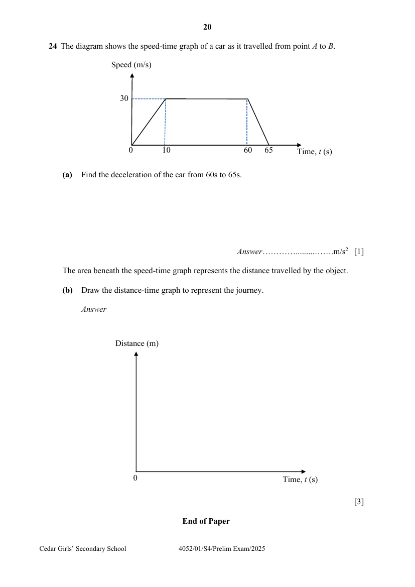
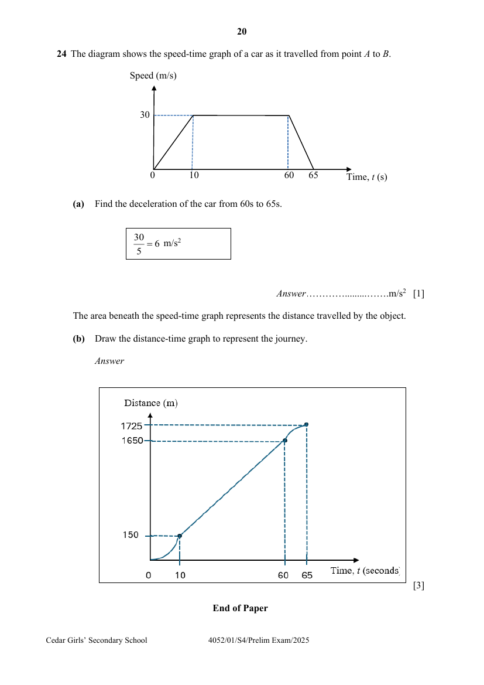

## Question

> **Marks:** (a) 1, (b) 3; total 4
> **Page:** 20

The diagram shows the speed-time graph of a car as it travelled from point $A$ to $B$.

**(a)** Find the deceleration of the car from $60\text{s}$ to $65\text{s}$. [1]

The area beneath the speed-time graph represents the distance travelled by the object.

**(b)** Draw the distance-time graph to represent the journey. [3]

---

End of Paper

## Answer Scheme

**(a)** Find the deceleration of the car from $60\text{s}$ to $65\text{s}$.

$$
\frac{30}{5} = 6\text{ m/s}^{2}
$$

**(b)** Draw the distance-time graph to represent the journey.

The area beneath the speed-time graph represents the distance travelled by the object. The distance-time graph passes through $(10, 150)$, $(60, 1650)$ and $(65, 1725)$.

---

End of Paper
