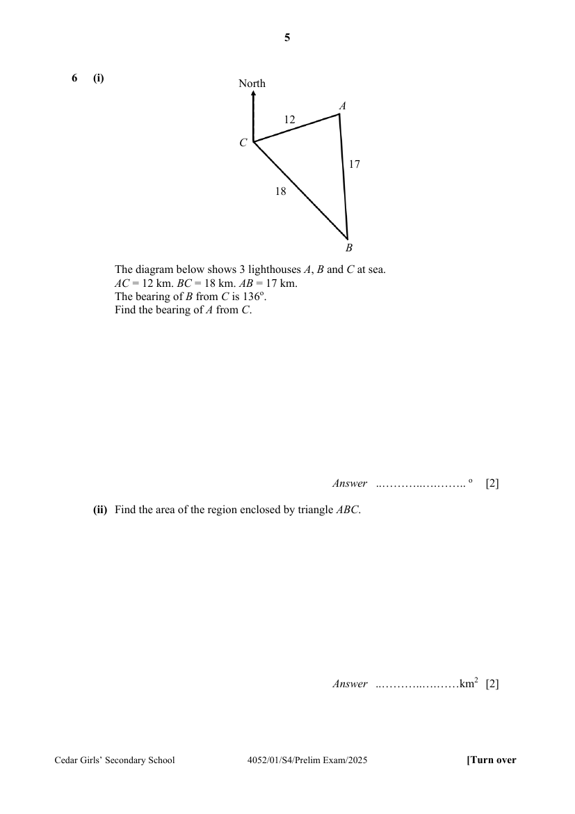

## Question

> **Marks:** (i) 2, (ii) 2; total 4
> **Page:** 5

The diagram below shows $3$ lighthouses $A$, $B$ and $C$ at sea.
$AC = 12\text{ km}$. $BC = 18\text{ km}$. $AB = 17\text{ km}$.
The bearing of $B$ from $C$ is $136^{\circ}$.

**(i)** Find the bearing of $A$ from $C$. [2]

**(ii)** Find the area of the region enclosed by triangle $ABC$. [2]

## Answer Scheme

The diagram below shows $3$ lighthouses $A$, $B$ and $C$ at sea. $AC = 12\text{ km}$. $BC = 18\text{ km}$. $AB = 17\text{ km}$. The bearing of $B$ from $C$ is $136^{\circ}$.

**(i)** Find the bearing of $A$ from $C$.

$$
\cos\angle ACB = \frac{12^{2}+18^{2}-17^{2}}{2(12)(18)} = 0.41435
$$

($5$ s.f.)

$$
\angle ACB = 65.522^{\circ}
$$

($3$ d.p.)

$$
\text{Bearing of }A\text{ from }C = 136^{\circ}-65.522^{\circ} = 070.5^{\circ}
$$

($1$ d.p.) (with zero in front)

**(ii)** Find the area of the region enclosed by triangle $ABC$.

$$
\text{Area of }ABC = \frac{1}{2}(12)(18)\sin 65.522^{\circ} = 98.3\text{ km}^{2}
$$
