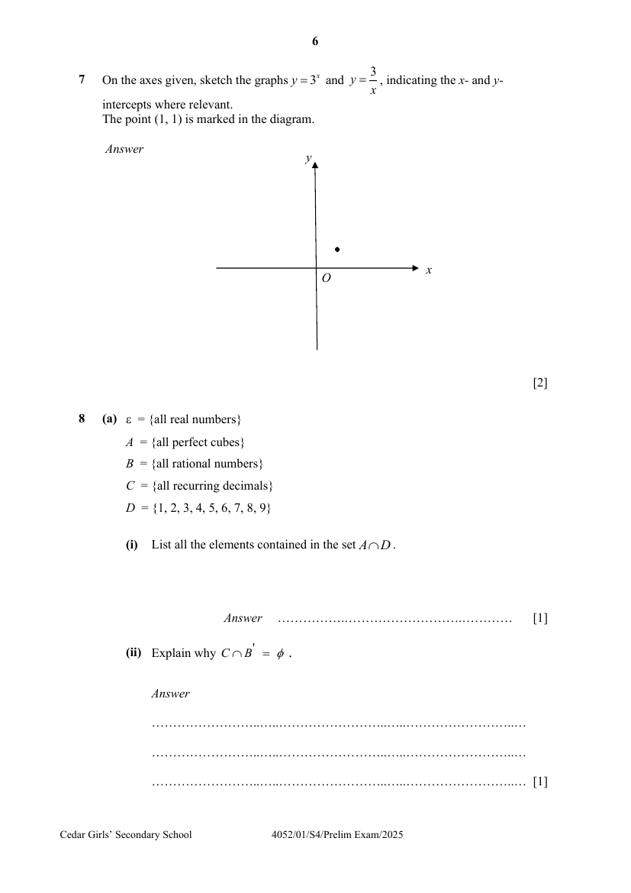

## Question

> **Marks:** 2
> **Page:** 6

On the axes given, sketch the graphs $y = 3^{x}$ and $y = \dfrac{3}{x}$, indicating the $x$- and $y$-intercepts where relevant.
The point $(1, 1)$ is marked in the diagram. [2]

## Answer Scheme

On the axes given, sketch the graphs $y = 3^{x}$ and $y = \dfrac{3}{x}$, indicating the $x$- and $y$-intercepts where relevant. The point $(1, 1)$ is marked in the diagram.

(shape and see intersection at above $x = 1$)

