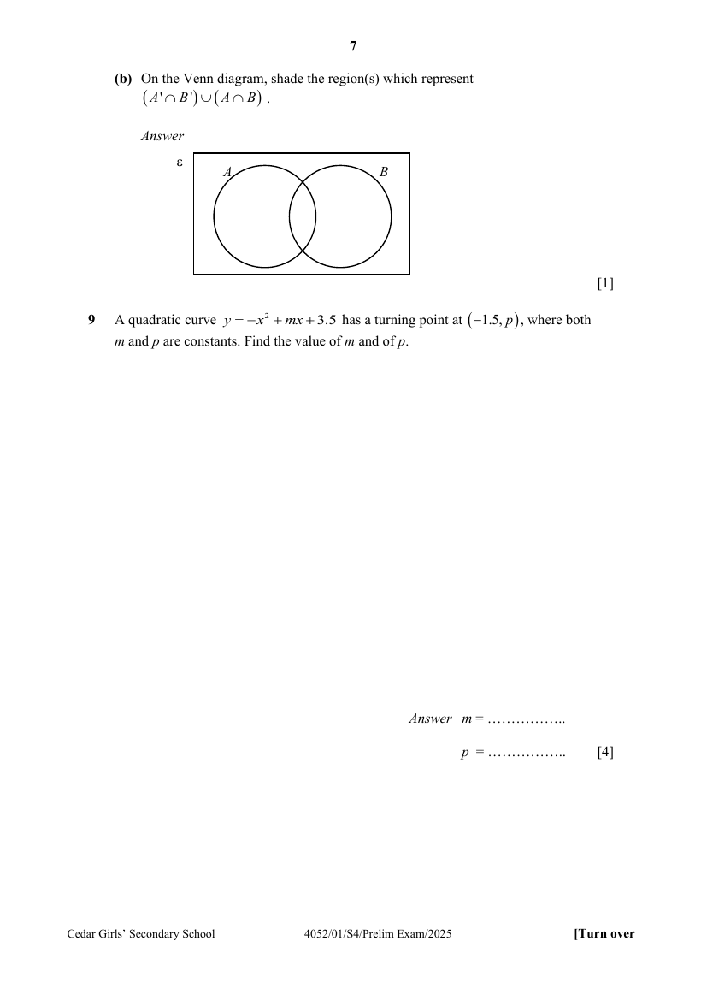
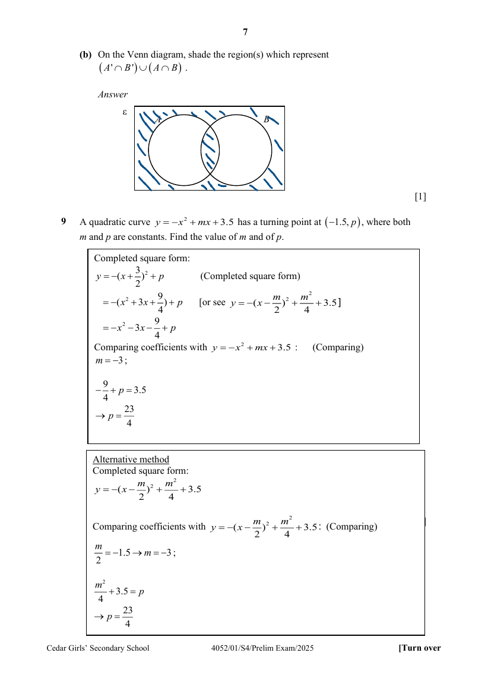

## Question

> **Marks:** (a)(i) 1, (a)(ii) 1, (b) 1; total 3
> **Page:** 6–7

**(a)** $\varepsilon = \{\text{all real numbers}\}$

$A = \{\text{all perfect cubes}\}$

$B = \{\text{all rational numbers}\}$

$C = \{\text{all recurring decimals}\}$

$D = \{1, 2, 3, 4, 5, 6, 7, 8, 9\}$

**(i)** List all the elements contained in the set $A \cap D$. [1]

**(ii)** Explain why $C \cap B' = \phi$. [1]

**(b)** On the Venn diagram, shade the region(s) which represent $(A' \cap B') \cup (A \cap B)$. [1]

## Answer Scheme

**(a)** $\varepsilon = \{\text{all real numbers}\}$

$A = \{\text{all perfect cubes}\}$

$B = \{\text{all rational numbers}\}$

$C = \{\text{all recurring decimals}\}$

$D = \{1, 2, 3, 4, 5, 6, 7, 8, 9\}$

**(i)** List all the elements contained in the set $A \cap D$.

$1, 8$

**(ii)** Explain why $C \cap B' = \phi$.

$B'$ are irrational numbers which are non-recurring decimal numbers.

Therefore, $C \cap B' = \phi$.

(Or saying rational numbers are recurring decimals)

**(b)** On the Venn diagram, shade the region(s) which represent $(A' \cap B') \cup (A \cap B)$.

