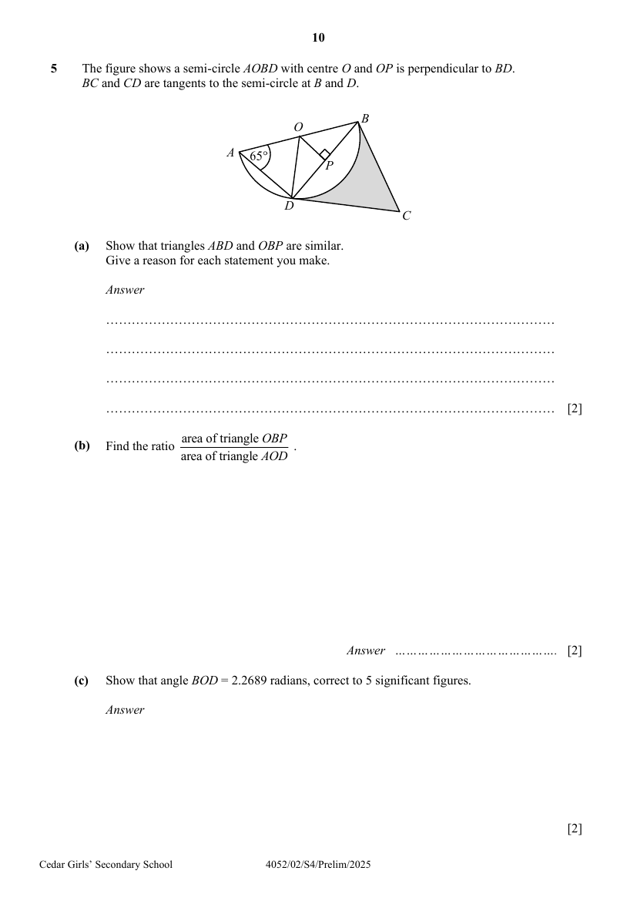

## Question

> **Marks:** (a) 2, (b) 2, (c) 2, (d)(i) 2, (d)(ii) 3; total 11
> **Page:** 10–11

The figure shows a semi-circle $AOBD$ with centre $O$ and $OP$ is perpendicular to $BD$.
$BC$ and $CD$ are tangents to the semi-circle at $B$ and $D$.
The diagram is marked $65^{\circ}$ at $A$.

**(a)** Show that triangles $ABD$ and $OBP$ are similar.
Give a reason for each statement you make. [2]

**(b)** Find the ratio $\dfrac{\text{area of triangle }OBP}{\text{area of triangle }AOD}$. [2]

**(c)** Show that angle $BOD = 2.2689$ radians, correct to $5$ significant figures. [2]

**(d)** It is given that the radius of the semi-circle is $4\text{ cm}$ and $BC = 8.58\text{ cm}$.

Calculate

**(i)** the perimeter of the shaded part, [2]

**(ii)** the area of the shaded part. [3]

## Answer Scheme

**(a)** $\angle ADB = 90^{\circ}$ (angle in semicircle)

So, $\angle ADB = \angle OPB$.

$\angle ABD$ is a common angle.

$\therefore \triangle ABD$ is similar to $\triangle OBP$. (Angle-angle similarity)

**(b)** Since

$$
\frac{\text{area of triangle }OBP}{\text{area of triangle }OBD} = \frac{1}{2}
$$

and area of triangle $OBD =$ area of triangle $AOD$,

$$
\frac{\text{area of triangle }OBP}{\text{area of triangle }AOD} = \frac{1}{2}
$$

**(c)** $\angle BOP = 65^{\circ}$ (similar triangles)

$$
\angle BOD = (65^{\circ}\times 2)\times\frac{\pi}{180^{\circ}} = 2.268928
$$

($7$ s.f.)

$$
= 2.2689\text{ radians}
$$

($5$ s.f.) (shown)

**(d) (i)** $BC = DC = 8.58\text{ cm}$ (tangents from ext. pt.)

$$
\text{Perimeter} = (8.58\times 2)+4(2.268928) = 26.2357 = 26.2\text{ cm}
$$

($3$ s.f.)

**(ii)** $\angle OBC = 90^{\circ}$ (tangent $\perp$ radius)

$$
\text{Area} = \left(2\times\frac{1}{2}\times 4\times 8.58\right)-\frac{1}{2}(4^{2})(2.268928) = 16.169 = 16.2\text{ cm}^{2}
$$

($3$ s.f.)
