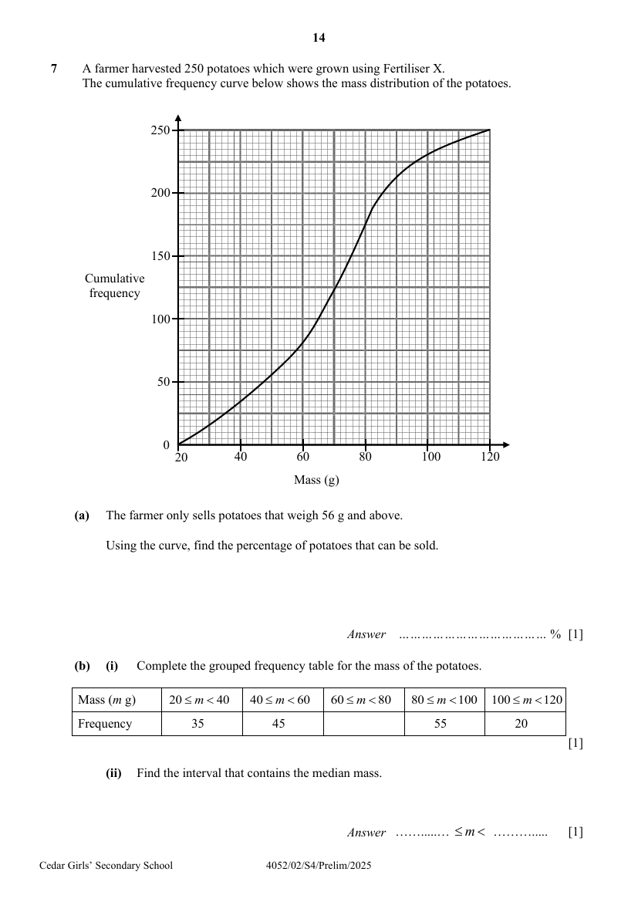

## Question

> **Marks:** (a) 1, (b)(i) 1, (b)(ii) 1, (b)(iii) 1, (b)(iv) 1, (c)(i) 2, (c)(ii) 2, (d) 2; total 11
> **Page:** 14–15

A farmer harvested $250$ potatoes which were grown using Fertiliser X.
The cumulative frequency curve below shows the mass distribution of the potatoes.

**(a)** The farmer only sells potatoes that weigh $56\text{ g}$ and above.

Using the curve, find the percentage of potatoes that can be sold. [1]

**(b)** **(i)** Complete the grouped frequency table for the mass of the potatoes.

| Mass ($m$ g) | $20 \leq m < 40$ | $40 \leq m < 60$ | $60 \leq m < 80$ | $80 \leq m < 100$ | $100 \leq m < 120$ |
| --- | --- | --- | --- | --- | --- |
| Frequency | $35$ | $45$ | | $55$ | $20$ |

[1]

**(ii)** Find the interval that contains the median mass. [1]

**(iii)** Calculate an estimate of the mean mass. [1]

**(iv)** Calculate an estimate of the standard deviation of the masses. [1]

**(c)** Two of the potatoes are selected at random, without replacement.

Find the probability that

**(i)** none has a mass between $60\text{ g}$ and $100\text{ g}$, [2]

**(ii)** one has a mass less than $60\text{ g}$ and the other has a mass greater than $100\text{ g}$. [2]

**(d)** The farmer harvested another $250$ potatoes that were grown using Fertiliser Y.
The estimated mean mass of this batch of potatoes is $62\text{ g}$.
The estimated standard deviation of the masses is $23\text{ g}$.

Make two comments comparing the mass of the potatoes grown using Fertiliser X and those grown using Fertiliser Y. [2]

## Answer Scheme

**(a)**

$$
\frac{250-70}{250}\times 100\% = 72\%
$$

**(b) (i)** Frequency for $60 \leq m < 80$ is $95$.

**(ii)** $60 \leq m < 80$

**(iii)** $68.4\text{ g}$

**(iv)** $22.6\text{ g}$

**(c) (i)**

$$
\frac{100}{250}\times\frac{99}{249} = \frac{66}{415}
$$

**(ii)**

$$
2\left(\frac{80}{250}\times\frac{20}{249}\right) = \frac{64}{1245}
$$

**(d)** On average, potatoes grown using Fertiliser X are heavier than those grown using Fertiliser Y, as they have a higher mean mass of $68.4\text{ g}$, compared to $62\text{ g}$.

The spread of the mass is comparable for both batches of potatoes, with SD being $22.6\text{ g}$ and $23\text{ g}$. / Mass of potatoes grown using Fertiliser X has a smaller spread, with a lower SD of $22.6\text{ g}$, rather than $23\text{ g}$.
