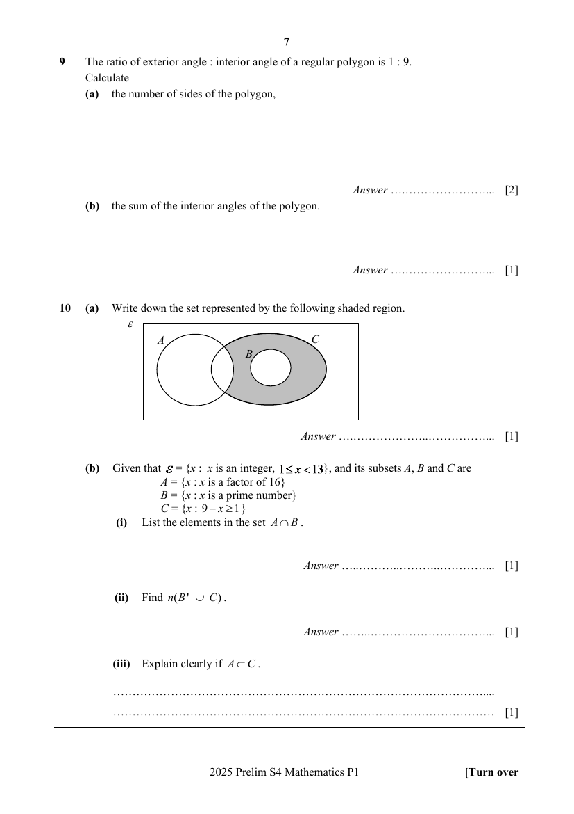

## Question

> **Marks:** (a) 1, (b)(i) 1, (b)(ii) 1, (b)(iii) 1; total 4
> **Page:** 7

**(a)** Write down the set represented by the following shaded region. [1]

**(b)** Given that $\varepsilon = \{x : x\text{ is an integer, }1 \leq x < 13\}$, and its subsets $A$, $B$ and $C$ are

$A = \{x : x\text{ is a factor of }16\}$

$B = \{x : x\text{ is a prime number}\}$

$C = \{x : 9-x \geq 1\}$

**(i)** List the elements in the set $A \cap B$. [1]

**(ii)** Find $n(B' \cup C)$. [1]

**(iii)** Explain clearly if $A \subset C$. [1]

## Answer Scheme

**(a)** $A' \cap (B' \cap C)$ or $(A \cup B)' \cap C$

**(b) (i)** $\{2\}$

**(ii)** $11$

**(iii)** All elements in Set $A$ are elements in Set $C$, $A \neq C$. Therefore $A \subset C$.
