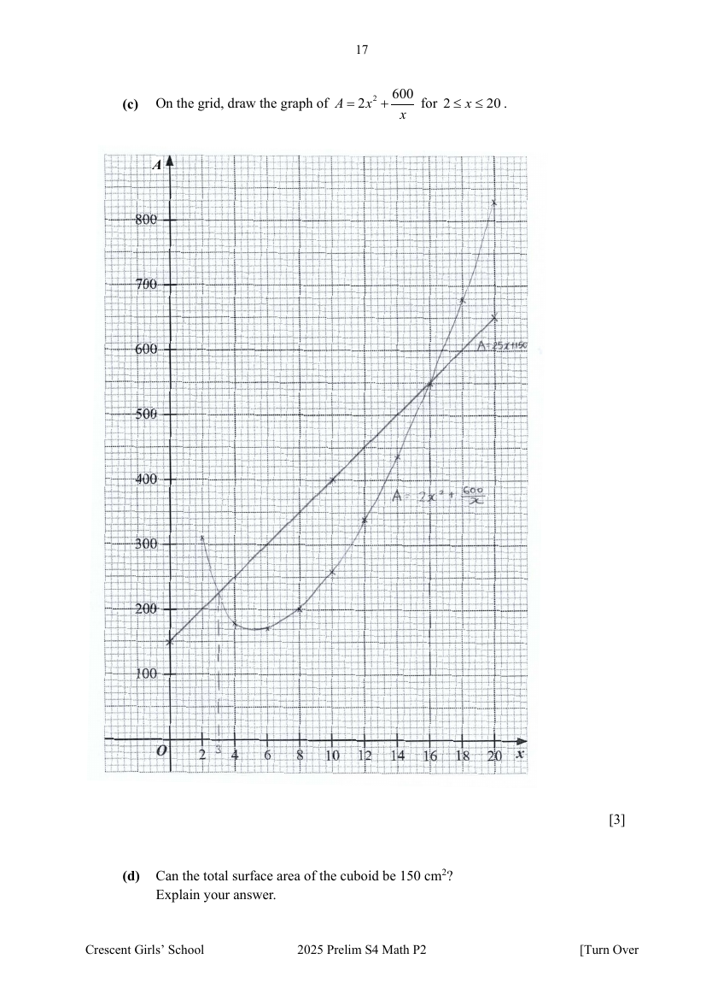

## Question

> **Marks:** (a) 2, (b) 1, (c) 3, (d) 1, (e)(i) 1, (e)(ii) 2; total 10
> **Page:** 16–18

A cuboid has a square base of sides $x\text{ cm}$.
Its height is $h\text{ cm}$ and its volume is $150\text{ cm}^{3}$.

**(a)** Show that the total surface area of the cuboid, $A = 2x^{2}+\dfrac{600}{x}$. [2]

**(b)** Complete the table of values for $A = 2x^{2}+\dfrac{600}{x}$. [1]

| $x$ | $2$ | $4$ | $6$ | $8$ | $10$ | $12$ | $14$ | $16$ | $18$ | $20$ |
| --- | --- | --- | --- | --- | --- | --- | --- | --- | --- | --- |
| $A$ | $308$ | $182$ | $172$ | $203$ | $260$ | $338$ | | $550$ | $681$ | $830$ |

**(c)** On the grid, draw the graph of $A = 2x^{2}+\dfrac{600}{x}$ for $2 \leq x \leq 20$. [3]

**(d)** Can the total surface area of the cuboid be $150\text{ cm}^{2}$?
Explain your answer. [1]

**(e)** A manufacturer designs cuboid packaging boxes with square bases. The total surface area must not exceed the material cost limit which is given by $A = 25x+150$.

**(i)** On the same grid, draw the straight line $A = 25x+150$ for $2 \leq x \leq 20$. [1]

**(ii)** Use the graph to find the possible lengths of the sides of the cuboid where the material cost is maximised. [2]

## Answer Scheme

**(a)** $h = \dfrac{150}{x^{2}}$

$$
A = 2x^{2}+4xh = 2x^{2}+\frac{600}{x}
$$

**(b)** When $x = 14$, $A = 435$.

**(c)** Draw $A = 2x^{2}+\dfrac{600}{x}$.

**(d)** Total surface area of the cuboid cannot be $150\text{ cm}^{2}$.

**(e) (ii)** $x = 3\text{ cm}$ or $16\text{ cm}$
