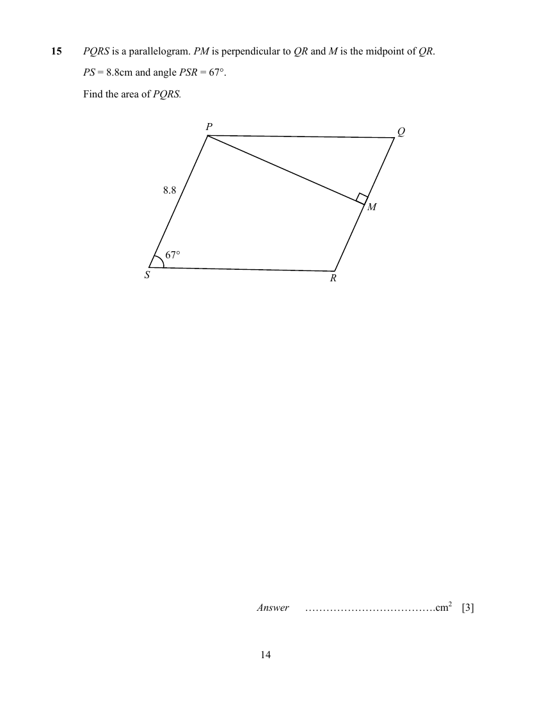

## Question

> **Marks:** 3
> **Page:** 14

$PQRS$ is a parallelogram. $PM$ is perpendicular to $QR$ and $M$ is the midpoint of $QR$.

$PS = 8.8\text{ cm}$ and angle $PSR = 67^{\circ}$.

Find the area of $PQRS$.

[3]

## Answer Scheme

$$
\tan 67^{\circ} = \frac{PM}{4.4}
$$

$$
PM = 4.4\tan 67^{\circ}
$$

$$
\text{Area} = (4.4\tan 67^{\circ})(8.8) = 91.2\text{ cm}^{2}
$$
