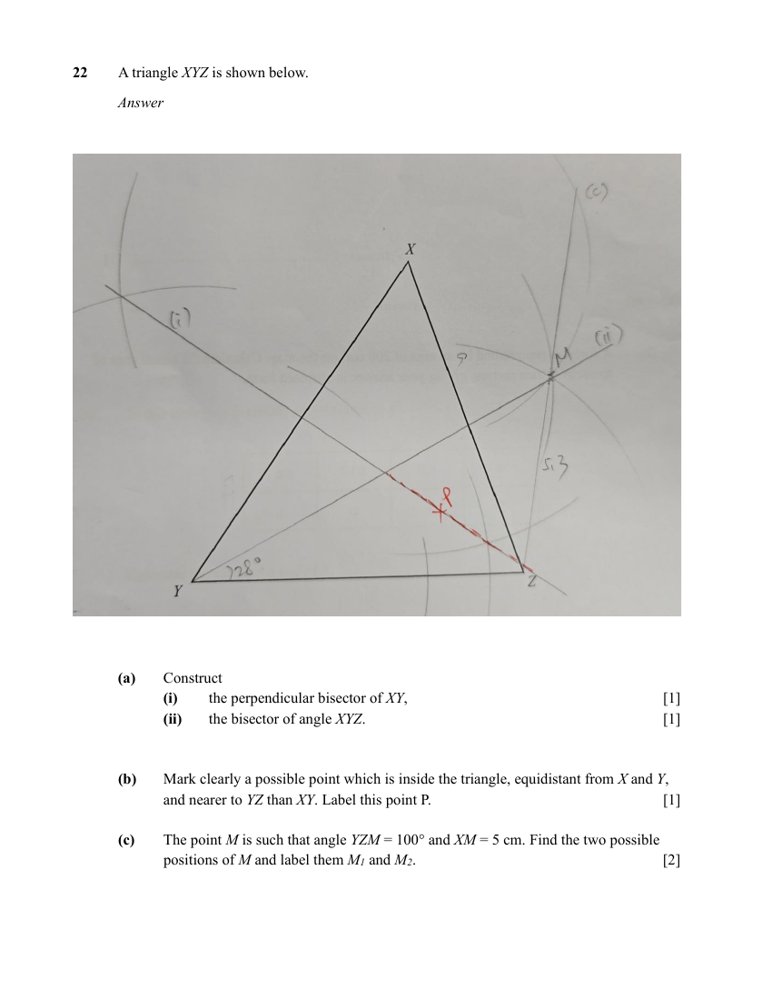

## Question

> **Marks:** (a)(i) 1, (a)(ii) 1, (b) 1, (c) 2; total 5
> **Page:** 21

A triangle $XYZ$ is shown below.

**(a)** Construct

**(i)** the perpendicular bisector of $XY$, [1]

**(ii)** the bisector of angle $XYZ$. [1]

**(b)** Mark clearly a possible point which is inside the triangle, equidistant from $X$ and $Y$, and nearer to $YZ$ than $XY$. Label this point $P$. [1]

**(c)** The point $M$ is such that angle $YZM = 100^{\circ}$ and $XM = 5\text{ cm}$. Mark and label the point $M$ at the position that is closer to point $Z$. Measure and write down the length $ZM$. [2]

## Answer Scheme

Construction. The point $M$ is such that angle $YZM = 100^{\circ}$ and $XM = 5\text{ cm}$. Find the two possible positions of $M$ and label them $M_{1}$ and $M_{2}$.

