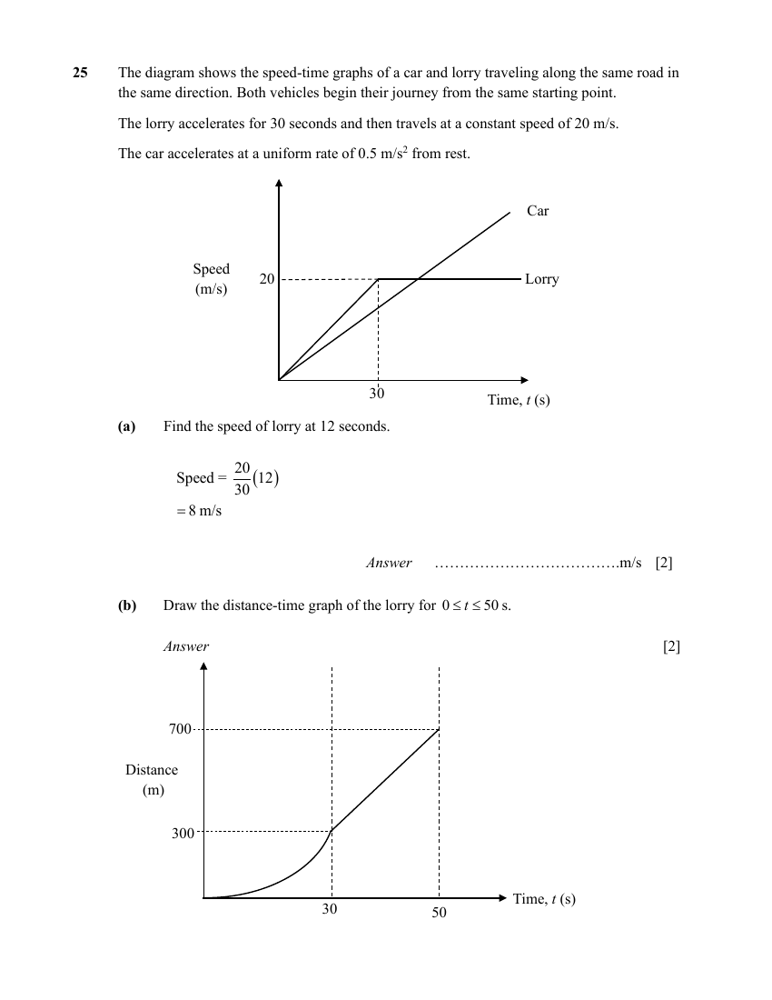

## Question

> **Marks:** (a) 2, (b) 2, (c) 4; total 8
> **Page:** 25–26

The diagram shows the speed-time graphs of a car and lorry traveling along the same road in the same direction. Both vehicles begin their journey from the same starting point.

The lorry accelerates for $30$ seconds and then travels at a constant speed of $20\text{ m/s}$.

The car accelerates at a uniform rate of $0.5\text{ m/s}^{2}$ from rest.

**(a)** Find the speed of lorry at $12$ seconds. [2]

**(b)** Draw the distance-time graph of the lorry for $0 \leq t \leq 50\text{ s}$. [2]

**(c)** Find the time taken for the car to meet the lorry. [4]

## Answer Scheme

**(a)**

$$
\text{Speed} = \frac{20}{30}(12) = 8\text{ m/s}
$$

**(b)** Distance-time graph through $(30,300)$ and $(50,700)$.

**(c)**

$$
\text{Distance by car} = \frac{1}{2}\left(\frac{1}{2}t\right)(t)
$$

$$
\text{Distance by lorry} = 300+20(t-30)
$$

$$
\frac{1}{4}t^{2}-20t+300 = 0
$$

$$
t = 60\quad (t = 20\text{ rejected})
$$
