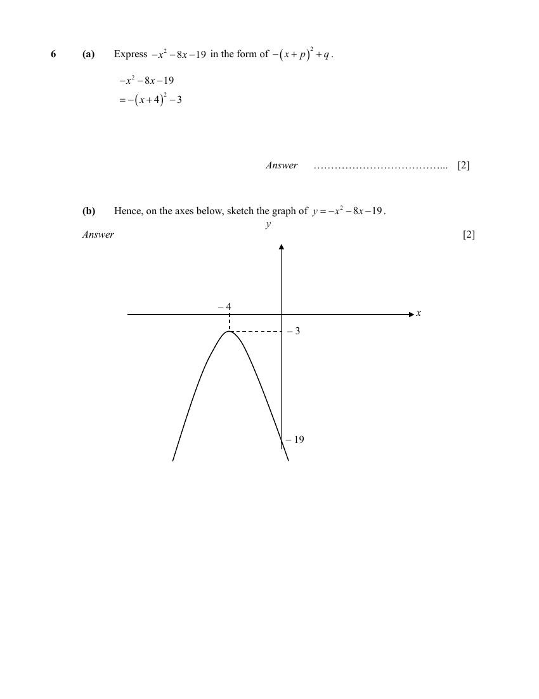

## Question

> **Marks:** (a) 2, (b) 2; total 4
> **Page:** 6

**(a)** Express $-x^{2}-8x-19$ in the form of $-(x+p)^{2}+q$. [2]

**(b)** Hence, sketch the graph of $y=-x^{2}-8x-19$ on the axes below.

Indicate clearly the turning point and axes intercept(s). [2]

## Answer Scheme

**(a)**

$$
-x^{2}-8x-19 = -(x+4)^{2}-3
$$

**(b)** Turning point $(-4,-3)$, $y$-intercept $-19$. No $x$-intercept.

