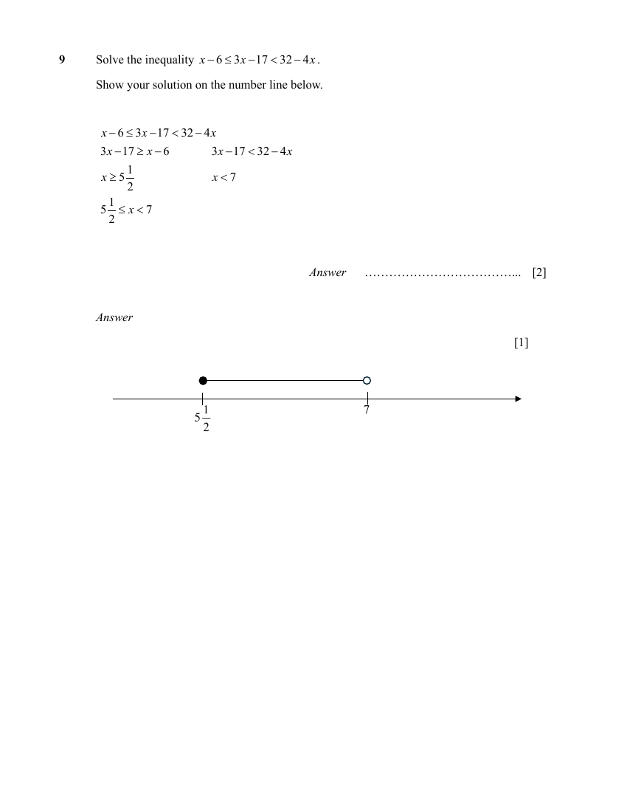

## Question

> **Marks:** inequality 2, number line 1; total 3
> **Page:** 8

Solve the inequality $x-6 \leq 3x-17 < 32-4x$.

Show your solution on the number line below. [2]

[1]

## Answer Scheme

$$
x-6 \leq 3x-17 \Rightarrow x \geq 5\frac{1}{2}
$$

$$
3x-17 < 32-4x \Rightarrow x < 7
$$

$$
5\frac{1}{2} \leq x < 7
$$

