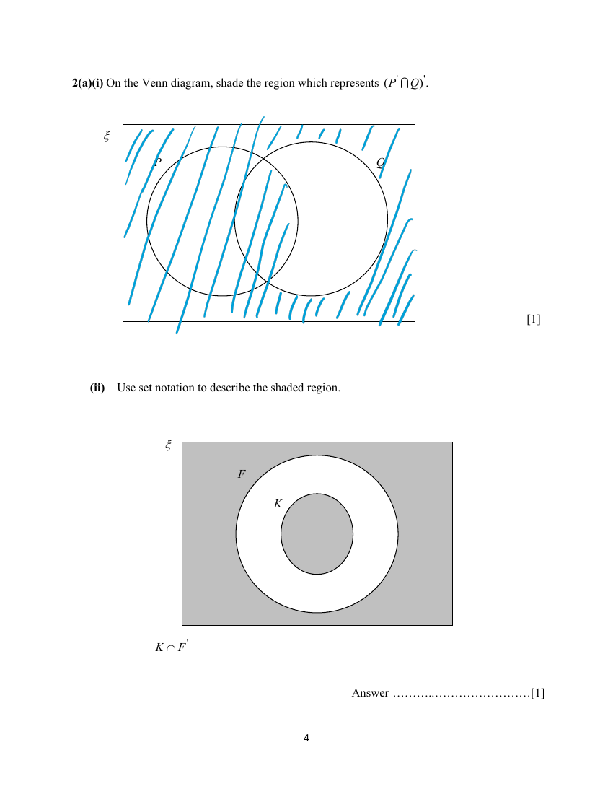

## Question

> **Marks:** (a)(i) 1, (a)(ii) 1, (b)(i) 1, (b)(ii) 1, (b)(iii) 2; total 6
> **Page:** 4–5

**(a)(i)** On the Venn diagram, shade the region which represents $(P' \cap Q)'$. [1]

**(a)(ii)** Use set notation to describe the shaded region. [1]

**(b)**

$$
\xi = \{\text{integers } x : 20 \leq x \leq 50\}
$$

$$
A = \{\text{perfect squares}\},\quad B = \{\text{prime numbers}\},\quad C = \{\text{multiples of } 7\}
$$

**(i)** List the elements in $A \cap C'$. [1]

**(ii)** Find the value of $n(B \cap C)$. [1]

**(iii)** A number, $p$, is chosen at random from the set $(B \cup C)$. Find the probability that $p \in A$. [2]

## Answer Scheme

**(a)(i)** Shade $(P'\cap Q)'$.

**(a)(ii)** $K \cap F'$

**(b)(i)** $25$, $36$

**(b)(ii)** $0$

**(b)(iii)** $B\cup C = \{21, 23, 28, 29, 31, 35, 37, 41, 42, 43, 47, 49\}$, $n(B\cup C) = 12$.

$$
P = \frac{1}{12}
$$

($49$ belongs to both $B\cup C$ and $A$.)
