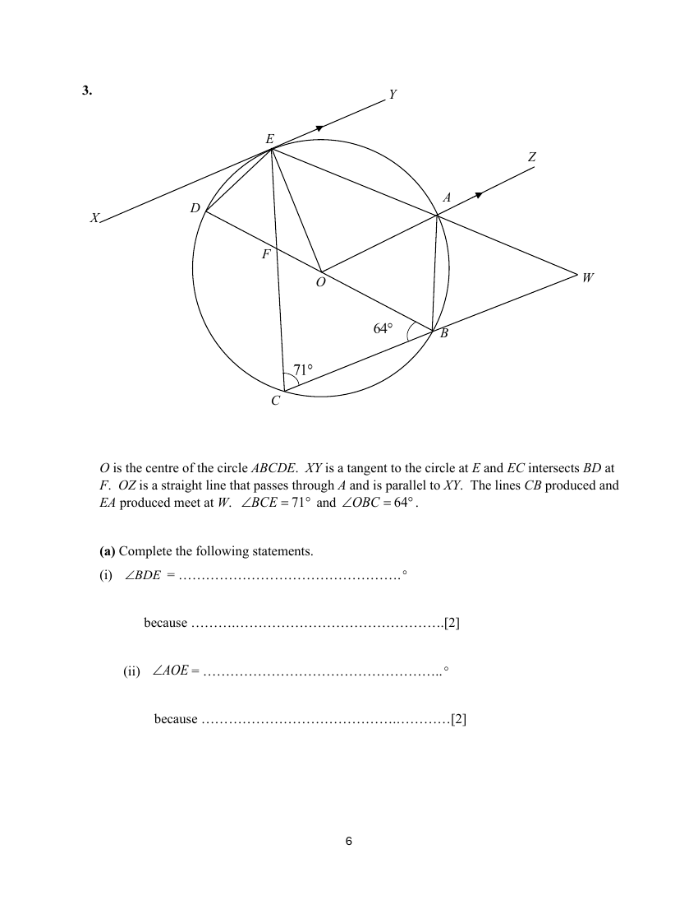

## Question

> **Marks:** (a)(i) 2, (a)(ii) 2, (b) 1, (c) 1, (d) 2; total 8
> **Page:** 6–7

$O$ is the centre of the circle $ABCDE$. $XY$ is a tangent to the circle at $E$ and $EC$ intersects $BD$ at $F$. $OZ$ is a straight line that passes through $A$ and is parallel to $XY$. The lines $CB$ produced and $EA$ produced meet at $W$. $\angle BCE = 71^{\circ}$ and $\angle OBC = 64^{\circ}$.

**(a)** Complete the following statements.

**(i)** $\angle BDE = \ldots{}^{\circ}$ because $\ldots$ [2]

**(ii)** $\angle AOE = \ldots{}^{\circ}$ because $\ldots$ [2]

**(b)** Find $\angle BOE$. [1]

**(c)** Find $\angle OCE$. [1]

**(d)** Find $\angle ABW$. [2]

## Answer Scheme

**(a)(i)** $\angle BDE = 71^{\circ}$ because angles in the same segment.

**(a)(ii)** $\angle AOE = 90^{\circ}$ because a tangent is perpendicular to the radius, and interior angles between parallel lines $OZ \parallel XY$.

**(b)** $\angle BOE = 71^{\circ}\times 2 = 142^{\circ}$

**(c)** $\angle OCE = 71^{\circ}-64^{\circ} = 7^{\circ}$

**(d)**

$$
\angle OEA = \frac{180^{\circ}-90^{\circ}}{2} = 45^{\circ}
$$

$\angle ABW = \angle AEC$ (exterior angle of cyclic quadrilateral) $= 45^{\circ}+7^{\circ} = 52^{\circ}$.
