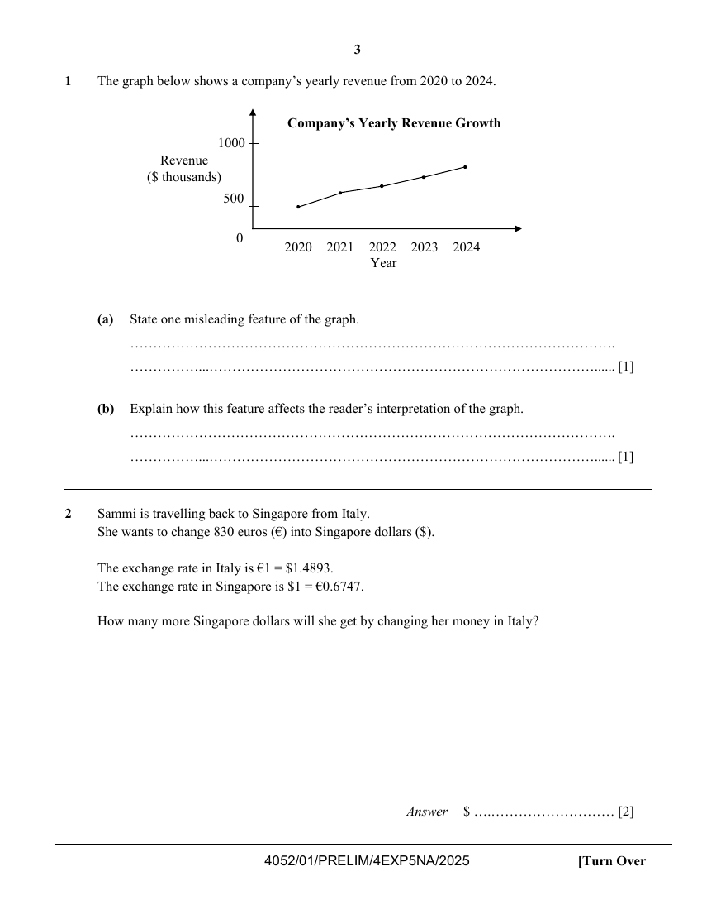

## Question

> **Marks:** (a) 1, (b) 1; total 2
> **Page:** 3

The graph below shows a company's yearly revenue from 2020 to 2024.

**(a)** State one misleading feature of the graph. [1]

**(b)** Explain how this feature affects the reader's interpretation of the graph. [1]

## Answer Scheme

**(a)** Inconsistent $y$-axis scale.

**(b)** The revenue growth appears to be more than doubled from 2020 compared to 2024 when in actual fact only increased from about &#36;500 000 to &#36;800 000.
