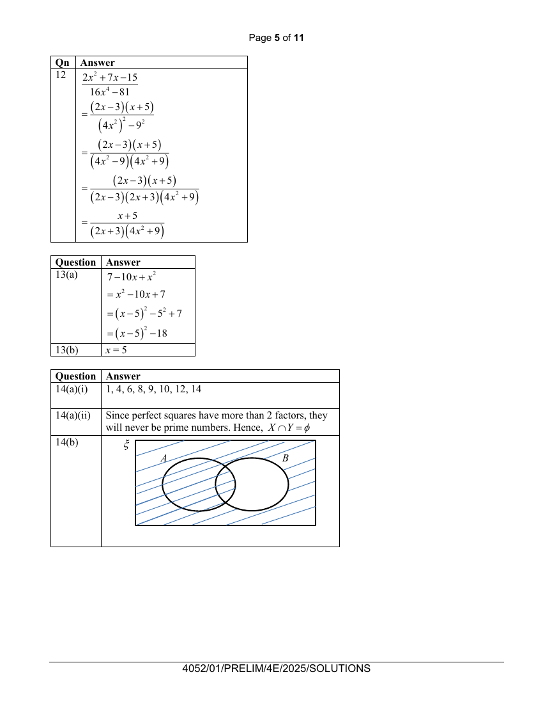

## Question

> **Marks:** (a)(i) 1, (a)(ii) 1, (b) 1; total 3
> **Page:** 9

**(a)** $\xi=\{\text{integers }x:1\leq x\leq 14\}$

$X=\{\text{perfect square}\}$

$Y=\{\text{prime numbers}\}$

**(i)** List the elements in $Y'$. [1]

**(ii)** Explain why $X\cap Y=\emptyset$. [1]

**(b)** On the Venn diagram, shade the region which represents $(A'\cap B)'$. [1]

## Answer Scheme

**(a) (i)** $1, 4, 6, 8, 9, 10, 12, 14$

**(ii)** Since perfect squares have more than 2 factors, they will never be prime numbers. Hence, $X\cap Y=\emptyset$.

**(b)**

