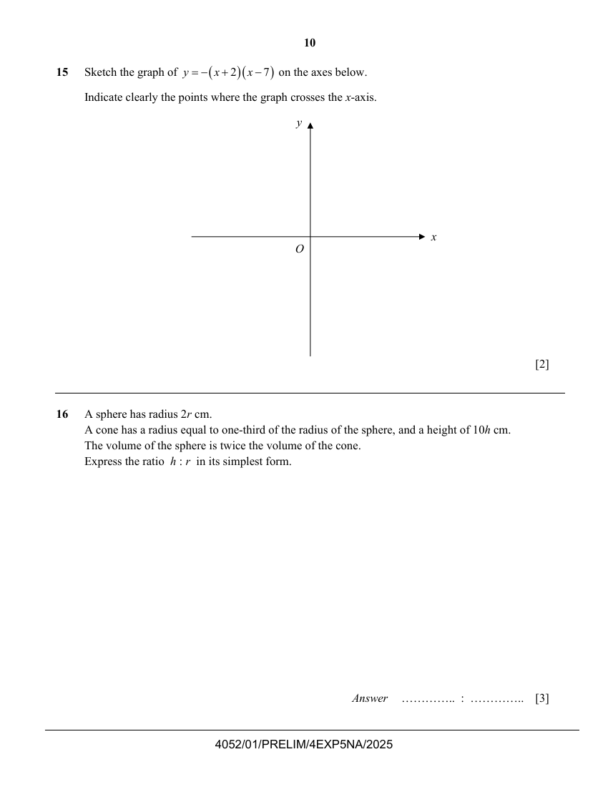
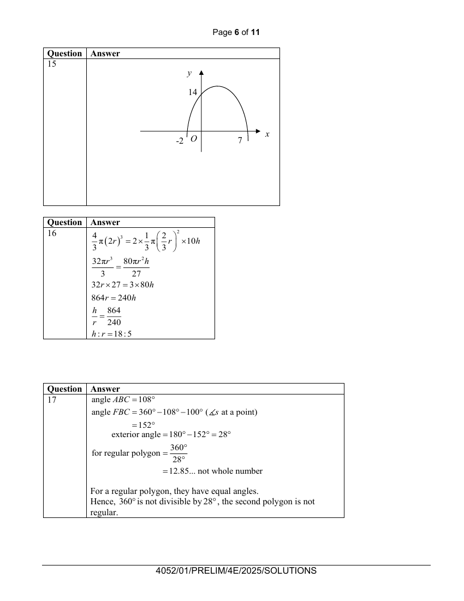

## Question

> **Marks:** 2
> **Page:** 10

Sketch the graph of $y=-(x+2)(x-7)$ on the axes below.
Indicate clearly the points where the graph crosses the $x$-axis. [2]

## Answer Scheme

The sketch crosses the $x$-axis at $-2$ and $7$, and the $y$-intercept is $14$.

