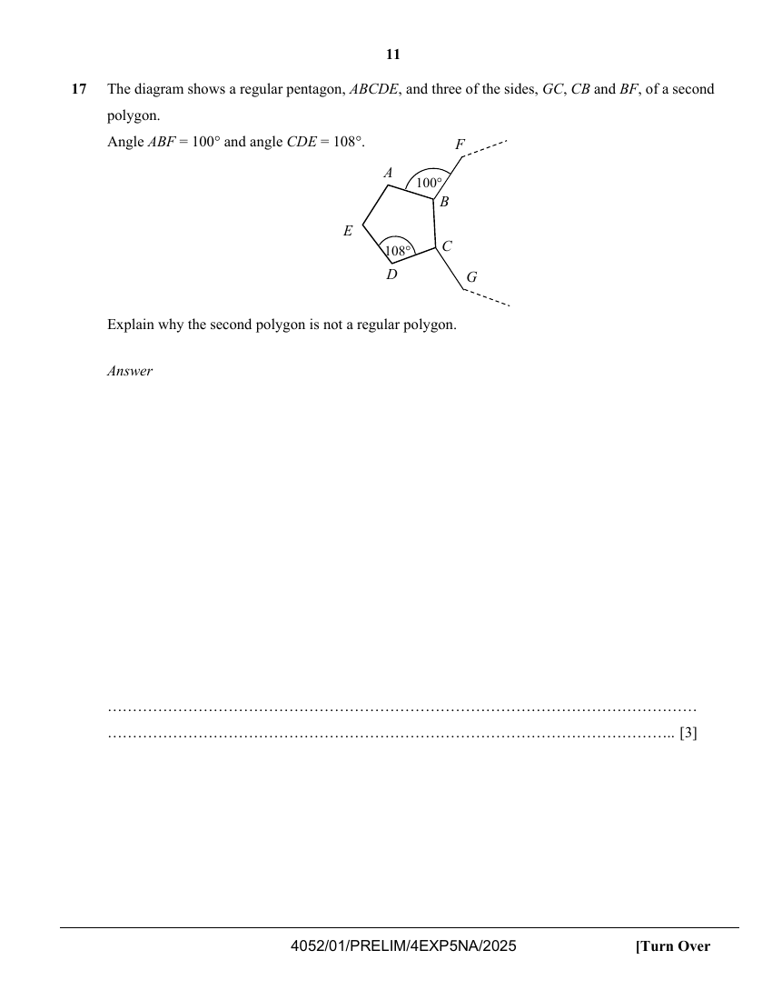

## Question

> **Marks:** 3
> **Page:** 11

The diagram shows a regular pentagon, $ABCDE$, and three of the sides, $GC$, $CB$ and $BF$, of a second polygon.
Angle $ABF=100^{\circ}$ and angle $CDE=108^{\circ}$.

Explain why the second polygon is not a regular polygon. [3]

## Answer Scheme

Angle $ABC=108^{\circ}$

$$
\text{angle }FBC=360^{\circ}-108^{\circ}-100^{\circ}=152^{\circ}
$$

($\angle$s at a point)

$$
\text{exterior angle}=180^{\circ}-152^{\circ}=28^{\circ}
$$

$$
\frac{360^{\circ}}{28^{\circ}}=12.85\ldots
$$

not a whole number.

For a regular polygon, they have equal angles.
Hence, $360^{\circ}$ is not divisible by $28^{\circ}$, the second polygon is not regular.
