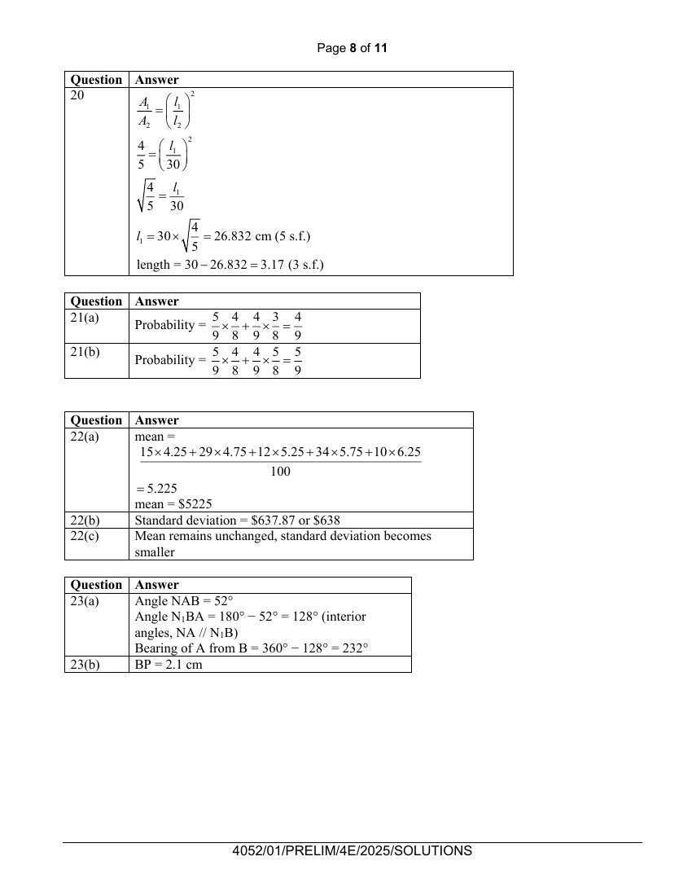

## Question

> **Marks:** (a) 2, (b) 2; total 4
> **Page:** 16

The diagram shows the position of an island $A$ at sea level.
Boat $B$ and ship $C$ are on the surface of the sea.
Ship $C$ lies due east of island $A$. Angle $BAC=38^{\circ}$.

**(a)** Calculate the bearing of $A$ from $B$. [2]

**(b)** On the diagram above, construct a line such that every point on this line is equidistant from the lines $AB$ and $AC$.
The line intersects $BC$ at $P$.
Measure the length $BP$. [2]

## Answer Scheme

**(a)** Angle $NAB=52^{\circ}$

Angle $N_{1}BA=180^{\circ}-52^{\circ}=128^{\circ}$ (interior angles, $NA\parallel N_{1}B$)

Bearing of $A$ from $B=360^{\circ}-128^{\circ}=232^{\circ}$

**(b)** $BP=2.1$ cm

