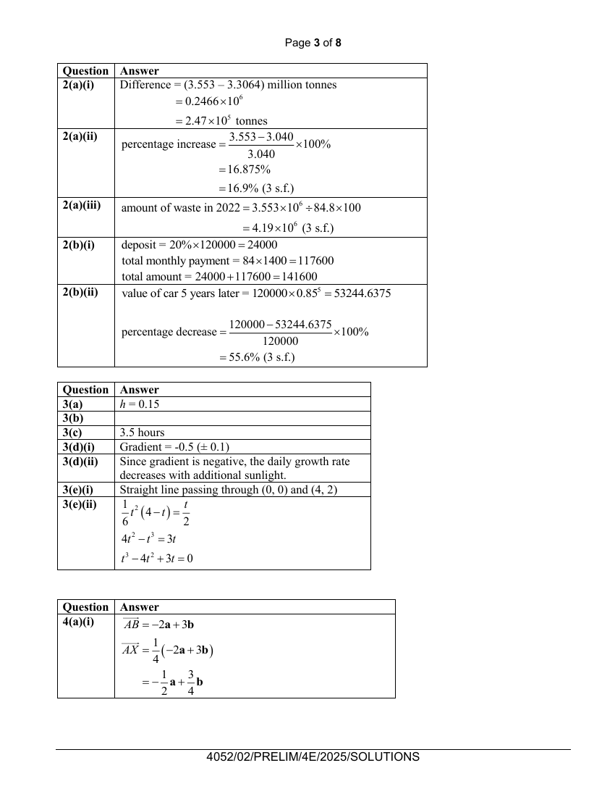

## Question

> **Marks:** (a) 1, (b) 3, (c) 1, (d)(i) 2, (d)(ii) 1, (e)(i) 1, (e)(ii) 2; total 11
> **Page:** 8–9

The daily growth rate, $h$ millimeters per day, of Plant A is related to the number of hours of sunlight it receives each day, $t$, by the formula $h=\dfrac{1}{6}t^{2}(4-t)$.

**(a)** Complete the table of values for $h=\dfrac{1}{6}t^{2}(4-t)$.
Values are given to 2 decimal places where appropriate. [1]

| $t$ | $0.5$ | $1$ | $1.5$ | $2$ | $2.5$ | $3$ | $3.5$ | $4$ |
| --- | --- | --- | --- | --- | --- | --- | --- | --- |
| $h$ |  | $0.5$ | $0.94$ | $1.33$ | $1.56$ | $1.5$ | $1.02$ | $0$ |

**(b)** On the grid opposite, draw the graph of $h=\dfrac{1}{6}t^{2}(4-t)$ for $0\leq t\leq 4$. [3]

**(c)** Use your graph to find the maximum number of hours of sunlight Plant A can receive to achieve a daily growth rate of 1 millimetre per day. [1]

**(d)**

**(i)** By drawing a tangent, find the gradient of the curve at $(3,1.5)$. [2]

**(ii)** What does the gradient in part (i) tell us about the effect of additional sunlight on the daily growth rate of plant A at this point? Explain your answer. [1]

The daily growth rate, $h$ millimeters per day, of another Plant B is related to the $t$ hours of sunlight it receives each day by the formula $2h=t$.

**(e)**

**(i)** On the grid above, draw the graph of $2h=t$ for $0\leq t\leq 4$. [1]

**(ii)** Find an equation in the form $t^{3}+pt^{2}+qt+r=0$, where $p$, $q$ and $r$ are constants to be found, such that the solutions represent the number of hours of sunlight when both Plant A and Plant B have the same daily growth rate. [2]

## Answer Scheme

**(a)** $h=0.15$

**(b)** Graph of $h=\dfrac{1}{6}t^{2}(4-t)$ for $0\leq t\leq 4$.

**(c)** 3.5 hours

**(d) (i)** Gradient $=-0.5$ ($\pm 0.1$)

**(ii)** Since gradient is negative, the daily growth rate decreases with additional sunlight.

**(e) (i)** Straight line passing through $(0,0)$ and $(4,2)$.

**(ii)**

$$
\frac{1}{6}t^{2}(4-t)=\frac{t}{2}
$$

$$
4t^{2}-t^{3}=3t
$$

$$
t^{3}-4t^{2}+3t=0
$$
