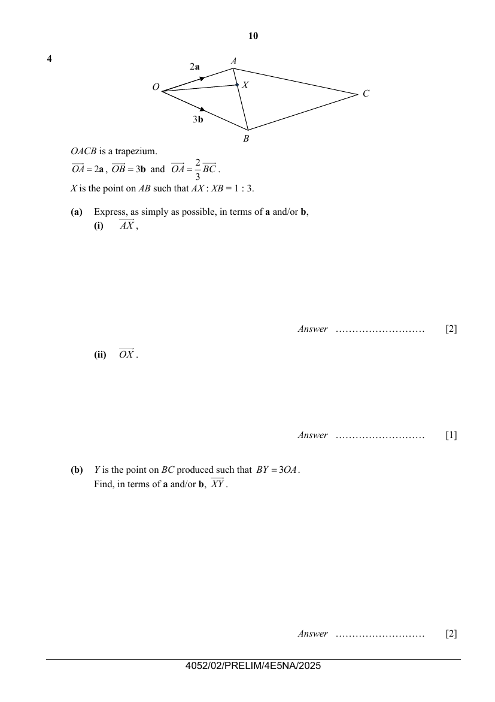

## Question

> **Marks:** (a)(i) 2, (a)(ii) 1, (b) 2, (c) 2, (d) 2, (e) 2; total 11
> **Page:** 10–11

$OACB$ is a trapezium.
$\overrightarrow{OA}=2\mathbf{a}$, $\overrightarrow{OB}=3\mathbf{b}$ and $\overrightarrow{OA}=\dfrac{2}{3}\overrightarrow{BC}$.
$X$ is the point on $AB$ such that $AX:XB=1:3$.

**(a)** Express, as simply as possible, in terms of $\mathbf{a}$ and/or $\mathbf{b}$,

**(i)** $\overrightarrow{AX}$, [2]

**(ii)** $\overrightarrow{OX}$. [1]

**(b)** $Y$ is the point on $BC$ produced such that $\overrightarrow{BY}=3\overrightarrow{OA}$.
Find, in terms of $\mathbf{a}$ and/or $\mathbf{b}$, $\overrightarrow{XY}$. [2]

**(c)** Explain why $O$, $X$ and $Y$ lie on a straight line. [2]

**(d)** Find the ratio of the area of triangle $OBX$ to the area of quadrilateral $OACB$. [2]

**(e)** $W$ is the point on $AB$ such that triangle $OAW$ is similar to triangle $CBW$.
Find, in terms of $\mathbf{a}$ and/or $\mathbf{b}$, $\overrightarrow{OW}$. [2]

## Answer Scheme

**(a) (i)**

$$
\overrightarrow{AB}=-2\mathbf{a}+3\mathbf{b}
$$

$$
\overrightarrow{AX}=\frac{1}{4}(-2\mathbf{a}+3\mathbf{b})=-\frac{1}{2}\mathbf{a}+\frac{3}{4}\mathbf{b}
$$

**(ii)**

$$
\overrightarrow{OX}=2\mathbf{a}-\frac{1}{2}\mathbf{a}+\frac{3}{4}\mathbf{b}=\frac{3}{2}\mathbf{a}+\frac{3}{4}\mathbf{b}
$$

**(b)**

$$
\overrightarrow{BY}=3(2\mathbf{a})=6\mathbf{a}
$$

$$
\overrightarrow{XY}=\overrightarrow{XB}+\overrightarrow{BY}=\frac{3}{4}(-2\mathbf{a}+3\mathbf{b})+6\mathbf{a}=\frac{9}{2}\mathbf{a}+\frac{9}{4}\mathbf{b}
$$

**(c)**

$$
\overrightarrow{OX}=\frac{1}{3}\overrightarrow{XY}
$$

Since $\overrightarrow{OX}$ is parallel to $\overrightarrow{XY}$, and $X$ is a common point, $O$, $X$ and $Y$ lie on a straight line.

**(d)**

$$
\frac{\text{Area of triangle }OBX}{\text{Area of triangle }OAB}=\frac{BX}{AB}=\frac{3}{4}
$$

$$
\frac{\text{Area of triangle }OAB}{\text{Area of triangle }ABC}=\frac{OA}{BC}=\frac{2}{3}=\frac{4}{6}
$$

$$
\frac{\text{Area of triangle }OBX}{\text{Area of quadrilateral }OACB}=\frac{3}{4+6}=\frac{3}{10}
$$

**(e)**

$$
\overrightarrow{OC}=3\mathbf{a}+3\mathbf{b}
$$

$$
\overrightarrow{OW}=\frac{2}{5}(3\mathbf{a}+3\mathbf{b})=\frac{6}{5}\mathbf{a}+\frac{6}{5}\mathbf{b}
$$
